# Práctica 2  - Integración de Objetos Inteligentes con TCP/IP

**Indicador de distancia distribuido: sensor ultrasónico en un ESP32, servidor de control TCP en una PC y actuador de LEDs en otro ESP32**


|  |  |
| --- | --- |
| **Universidad** | Universidad Católica Boliviana “San Pablo” |
| **Carrera** | Ingeniería de Sistemas |
| **Asignatura** | SIS-234 Internet de las Cosas / 2-2026 |
| **Fecha de entrega** | 13 de octubre de 2026 |
| **Repositorio** | [https://github.com/Andres004/SecondProject-IoT](https://github.com/Andres004/SecondProject-IoT) |
| **Grupo** | 1 |
| **Integrantes** | Ricardo Andres Andrade Vargas · Dabner Eliezer Orozco Veizaga |

---
## Contenido

1. [Requerimientos funcionales y no funcionales](#1-requerimientos-funcionales-y-no-funcionales)
   - [1.1 Alcance y nomenclatura](#11-alcance-y-nomenclatura) · [1.2 Requerimientos funcionales](#12-requerimientos-funcionales) · [1.3 Rangos y lógica de control](#13-rangos-y-lógica-de-control) · [1.4 Histéresis y lecturas inválidas](#14-histéresis-y-lecturas-inválidas) · [1.5 Requerimientos no funcionales](#15-requerimientos-no-funcionales) · [1.6 Matriz de trazabilidad](#16-matriz-de-trazabilidad)
2. [Análisis y diseño](#2-análisis-y-diseño)
   - [2.1 Arquitectura](#21-diagrama-de-arquitectura-del-sistema) · [2.2 Circuitos](#22-diagramas-de-circuito) · [2.3 Clases](#23-diagramas-de-clases) · [2.4 Secuencia](#24-diagramas-de-secuencia) · [2.5 Protocolo](#25-especificación-del-protocolo-de-aplicación)
3. [Desarrollo e implementación](#3-desarrollo-e-implementación)
   - [3.1 Entorno](#31-entorno-de-desarrollo) · [3.2 Repositorio](#32-estructura-del-repositorio) · [3.3 Módulos](#33-módulos-y-clases) · [3.4 Configuración](#34-configuración-de-red-y-credenciales) · [3.5 Ejecución](#35-compilación-carga-y-ejecución) · [3.6 Fragmentos clave](#36-fragmentos-clave) · [3.7 Temporización](#37-temporización-sin-bloqueos) · [3.8 Logs](#38-registro-de-eventos-logs) · [3.9 Buenas prácticas](#39-buenas-prácticas-aplicadas) · [3.10 Cobertura](#310-cobertura-de-los-requerimientos)
4. [Pruebas y validaciones](#4-pruebas-y-validaciones)
   - [4.1 Plan de Pruebas](#41-plan-de-pruebas) · [4.2 Físicas y de entorno](#42-a-pruebas-físicas-y-de-entorno) · [4.3 Automáticas](#43-b-pruebas-automáticas) · [4.4 Análisis de errores](#44-análisis-de-errores)
5. [Resultados](#5-resultados)
6. [Conclusiones](#6-conclusiones)
7. [Recomendaciones](#7-recomendaciones)
8. [Anexos](#8-anexos)

---

## 1. Requerimientos funcionales y no funcionales

### 1.1 Alcance y nomenclatura

El sistema tiene tres nodos conectados a la misma red WiFi:

| Sigla | Nodo | Hardware | Función |
|---|---|---|---|
| OI-1 | Objeto inteligente sensor | ESP32 DevKit de 30 pines + sensor ultrasónico HC-SR04 | Mide la distancia 10 veces por segundo y envía cada lectura al servidor |
| S | Servidor de control | PC con Windows que ejecuta [server/tcp_server.py](server/tcp_server.py) | Clasifica cada lectura, decide el comando y se lo envía al actuador |
| OI-2 | Objeto inteligente actuador | ESP32-DevKitC de 38 pines + 3 LEDs (rojo, amarillo y blanco) | Aplica cada comando en los LEDs y confirma que lo aplicó |

OI-1 y OI-2 son clientes TCP del servidor. Toda la lógica de control está en el servidor: OI-1 solo mide y OI-2 solo obedece.

### 1.2 Requerimientos funcionales

RF1 a RF4 definen la función básica del sistema: medir, clasificar, actuar y comunicarse. RF5 a RF7 hacen que la indicación sea estable y que el sistema siga siendo confiable ante lecturas inválidas y fallas de comunicación.

| ID | Requerimiento | Criterio de aceptación |
| --- | --- | --- |
| RF1 | Medir la distancia entre el sensor ultrasónico y el objeto que tiene enfrente. | OI-1 obtiene una lectura en cm, con resolución de 0.1 cm, en cada medición. Si el eco no termina en 25 ms, la lectura se informa como inválida (`NAN`). |
| RF2 | Clasificar cada lectura en uno de tres rangos contiguos y sin solapamiento. | Cada lectura válida (2.0 ≤ d ≤ 200.0 cm) pertenece a un solo rango de la Tabla 1. Los límites 20.0 y 40.0 pertenecen al rango superior. |
| RF3 | Activar los actuadores con un comportamiento distinto para cada rango. | NEAR: solo el LED rojo parpadea. MEDIUM: solo el amarillo parpadea. FAR: solo el blanco está encendido fijo. ERROR: los tres parpadean juntos. El parpadeo es de 2 Hz (250 ms encendido y 250 ms apagado) y no se reinicia mientras el estado no cambia. |
| RF4 | Enviar las lecturas de OI-1 al servidor y los comandos del servidor a OI-2 mediante sockets TCP sobre WiFi IEEE 802.11, con un protocolo de aplicación propio. | OI-1 y OI-2 abren una conexión TCP con el puerto 5050 del servidor a través de una red WiFi de 2.4 GHz y se identifican con `REGISTER`. Todos los mensajes cumplen la especificación de §2.5: OI-2 confirma cada comando con `ACK <seq>` después de aplicarlo, y el servidor responde `ERROR <código>` a un mensaje inválido sin cerrar la conexión. |
| RF5 | Mantener estable la indicación cuando el objeto está cerca de una frontera. | La zona cambia solo cuando la lectura pasa la frontera por al menos 2.0 cm (Tabla 2). Ejemplo: desde NEAR, 21.9 cm mantiene NEAR y 22.0 cm cambia a MEDIUM. |
| RF6 | Propagar y tolerar las lecturas inválidas. | OI-1 envía también las lecturas inválidas. El servidor considera inválida toda lectura no finita, menor que 2.0 cm o mayor que 200.0 cm. Una o dos inválidas seguidas no cambian la zona ni su histéresis; la tercera seguida cambia a ERROR. |
| RF7 | Pasar a un estado de falla seguro y distinguible, y recuperar la comunicación sin intervención. | (a) Si el sensor se desconecta o pasa 1.0 s sin enviar lecturas, el servidor pasa a ERROR y se lo ordena a OI-2, que lo confirma (`ACK 0`) en ≤ 1.5 s desde la última lectura recibida. (b) Si OI-2 pierde la conexión con el servidor (conexión cerrada o WiFi caída), muestra ERROR por sí mismo. (c) Tras una caída del servidor o de la red, OI-1 y OI-2 reintentan la conexión cada 2 s sin reiniciarse, se registran de nuevo y OI-2 recibe el estado vigente. |

### 1.3 Rangos y lógica de control

El algoritmo de control se ejecuta en el servidor ([zone_controller.py](server/zone_controller.py)) y todos sus valores están en [config.py](server/config.py). En las tablas, *d* es la distancia, en centímetros, que llega en el mensaje `POST`.

**Tabla 1.** Estados del sistema

| Estado | Condición | Comando enviado a OI-2 | Comportamiento visible |
|---|---|---|---|
| NEAR (cerca) | 2.0 ≤ d < 20.0 | `RED BLINK` | LED rojo parpadeando a 2 Hz |
| MEDIUM (medio) | 20.0 ≤ d < 40.0 | `YELLOW BLINK` | LED amarillo parpadeando a 2 Hz |
| FAR (lejos) | 40.0 ≤ d ≤ 200.0 | `WHITE ON` | LED blanco encendido fijo |
| ERROR | Tercera lectura inválida seguida; sensor desconectado o 1.0 s sin lecturas; estado inicial, antes de la primera lectura | `ALL BLINK` | Los tres LEDs parpadeando juntos a 2 Hz |

- **Límites.** 2.0 cm pertenece a NEAR; 20.0 cm, a MEDIUM; 40.0 cm y 200.0 cm, a FAR. 1.9 cm y 200.1 cm son inválidas. Las pruebas unitarias de [test_zone_controller.py](server/tests/test_zone_controller.py) usan exactamente esos valores.
- **Sin redondeo.** El servidor compara el número recibido tal como llega. OI-1 lo envía con un decimal, una resolución de 0.1 cm, más fina que la exactitud del sensor.
- **Contigüidad y no solapamiento.** Sean V = [2.0, 200.0] el rango válido, NEAR = [2.0, 20.0), MEDIUM = [20.0, 40.0) y FAR = [40.0, 200.0]:
  - NEAR ∪ MEDIUM ∪ FAR = [2.0, 200.0] = V, porque cada intervalo empieza donde termina el anterior.
  - NEAR ∩ MEDIUM = ∅ y MEDIUM ∩ FAR = ∅, porque 20.0 y 40.0 están solo en el intervalo superior. NEAR ∩ FAR = ∅, porque MEDIUM los separa.
  - Por lo tanto, cada lectura válida pertenece a exactamente un rango, y una lectura fuera de V (o no numérica, o infinita) no pertenece a ninguno.
- **Rango de trabajo.** El HC-SR04 no mide por debajo de 2 cm (zona ciega). Su hoja de datos indica un alcance de 400 cm, pero con este montaje las lecturas solo fueron continuas hasta unos 2 m; más lejos el eco se pierde con frecuencia (prueba A03). Por eso los límites de V son 2 y 200 cm: una lectura fuera de ellos se trata como inválida. La prueba A03 comprueba los dos límites con el sensor real.
- **Error distinguible.** El patrón de ERROR (los tres LEDs parpadeando) no coincide con el de ninguna zona, así que una falla detectada nunca se confunde con una zona; en particular, con FAR, la indicación de “objeto lejos”. El único caso de falla que el sistema no detecta se analiza en §7.

### 1.4 Histéresis y lecturas inválidas

La Tabla 1, implementada en `classify()`, define a qué rango pertenece una lectura. La zona que muestra el sistema la decide la máquina de estados `ZoneController`, que agrega dos reglas: la histéresis y la tolerancia a lecturas inválidas.

**Tabla 2.** Zona siguiente para una lectura válida, según la zona actual (umbrales en cm, `HYSTERESIS_CM = 2.0`)

| Zona actual | Pasa a NEAR si | Pasa a MEDIUM si | Pasa a FAR si | Se mantiene si |
|---|---|---|---|---|
| NEAR | — | 22.0 ≤ d < 42.0 | d ≥ 42.0 | d < 22.0 |
| MEDIUM | d < 18.0 | — | d ≥ 42.0 | 18.0 ≤ d < 42.0 |
| FAR | d < 18.0 | 18.0 ≤ d < 38.0 | — | d ≥ 38.0 |
| ERROR | d < 20.0 | 20.0 ≤ d < 40.0 | d ≥ 40.0 | Solo con lecturas inválidas |

- **Histéresis.** Para salir de una zona, la lectura tiene que pasar la frontera por al menos 2 cm. Los umbrales son `NEAR_TO_MEDIUM_CM = 22.0`, `MEDIUM_TO_NEAR_CM = 18.0`, `MEDIUM_TO_FAR_CM = 42.0` y `FAR_TO_MEDIUM_CM = 38.0`. Un objeto quieto en 21 cm se queda en la zona en la que estaba.
- **Saltos.** NEAR → FAR (d ≥ 42.0) y FAR → NEAR (d < 18.0) ocurren en una sola transición.
- **Salida de ERROR.** La primera lectura válida se clasifica directamente con la Tabla 1, sin histéresis, porque no hay una zona anterior que proteger.
- **Lecturas inválidas.** La primera y la segunda seguidas no cambian la zona ni sus umbrales; la tercera seguida cambia a ERROR, y una lectura válida reinicia el conteo. Como una lectura inválida aislada no borra la zona, tampoco borra la memoria de la histéresis.
- **Justificación de los valores.** Los 2 cm superan la dispersión de las lecturas de un objeto quieto, como confirman A02 (máximo − mínimo ≤ 1.0 cm en cada punto) y A04 (ningún cambio de zona con el objeto quieto en 20 y 40 cm). Con 10 lecturas por segundo, la tercera lectura inválida llega 200 ms después de la primera: una pérdida aislada del eco (por ejemplo, por una superficie inclinada) no produce un ERROR falso, y una falla persistente se muestra enseguida.

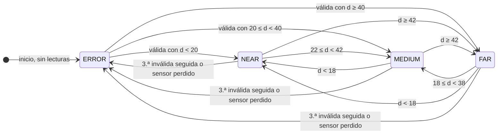

**Figura 1.** Máquina de estados del algoritmo de control. Las transiciones entre zonas usan los umbrales con histéresis de la Tabla 2; desde ERROR la clasificación es directa. Las lecturas que no cumplen ninguna condición de salida dejan el estado como está, igual que la primera y la segunda lectura inválida seguidas. Cada transición que cambia el estado produce un `SET` hacia OI-2.

### 1.5 Requerimientos no funcionales

| ID | Atributo | Valor declarado | Método de verificación | Prueba |
|---|---|---|---|---|
| RNF1 | Estabilidad | Operación continua de los tres nodos durante ≥ 10 min, con 0 reinicios (ningún `BOOT` nuevo en OI-1 ni en OI-2 y ningún reinicio de `seq`) y 0 bloqueos (ningún intervalo de 1 s o más entre dos lecturas recibidas por el servidor). Si ocurre una desconexión, se recupera sola (RNF5). | Corrida de al menos 10 min. Del CSV del servidor se obtienen los reinicios (`seq` que vuelve atrás), las desconexiones, las lecturas perdidas e inválidas y el intervalo máximo entre lecturas; en los logs de OI-1 y OI-2 se buscan `BOOT` nuevos. | B07 |
| RNF2 | Exactitud | Error absoluto de cada lectura individual ≤ 3 cm respecto a una regla, en el rango de trabajo de 5 a 100 cm. | Al menos 10 lecturas por punto de referencia, en puntos repartidos entre 5 y 100 cm que incluyen ambos extremos y las fronteras de 20 y 40 cm. Se informan mínimo, máximo, promedio, error máximo individual y error del promedio. | A02 |
| RNF3 | Tiempo de respuesta extremo a extremo | ≤ 1 s en el peor caso medido, desde que el objeto cruza el umbral de transición hasta que OI-2 muestra el nuevo estado. | En al menos 10 cambios de zona: 100 ms + `latency_ms` del CSV del servidor. | A05 |
| RNF4 | Frecuencia de muestreo | ≥ 5 lecturas/s enviadas por OI-1 y recibidas por el servidor. El diseño es de 10 lecturas/s. | Conteo de eventos `POST` del CSV del servidor en cada ventana de 10 s de la corrida de 10 min. Como `seq` aumenta de uno en uno, los saltos de `seq` muestran las lecturas enviadas que no llegaron. | B07 |
| RNF5 | Tiempo de reconexión | ≤ 3 s desde que el servidor vuelve a escuchar hasta que cada cliente queda registrado. | Reloj del servidor: t(`REGISTER`) − t(`START`) en al menos 3 reinicios del servidor. | B06 |

Justificación de los valores declarados:

- **RNF2 (5 a 100 cm):** cubre las dos fronteras (20 y 40 cm) con margen. Por debajo de 5 cm el sensor se acerca a su zona ciega.
- **RNF3 (≤ 1 s):** el tiempo de respuesta se estima como 100 ms (lo máximo que tarda OI-1 en tomar la siguiente lectura) más `latency_ms`, el tiempo que mide el servidor entre el `POST` que cambia la zona y el `ACK` de OI-2. Ambos tiempos se toman con el reloj del servidor, porque los relojes de las placas no están sincronizados.
- **RNF4 (≥ 5 lecturas/s):** el diseño produce 10 lecturas/s; el umbral deja margen para pequeñas demoras.
- **RNF5 (≤ 3 s):** hay un intento de conexión cada 2 s; el resto es margen.

### 1.6 Matriz de trazabilidad

| Requisito | Diseño | Implementación | Prueba |
|---|---|---|---|
| RF1 Medir la distancia | §2.2 circuito de OI-1 | [UltrasonicSensor.cpp](src/sensor/UltrasonicSensor.cpp): `UltrasonicSensor` | A01, A02, A03, A06, B05 |
| RF2 Tres rangos | §1.3 (Tabla 1); §1.4 (Figura 1) | [zone_controller.py](server/zone_controller.py): `classify()` | A01, A03, B01, B03, B07 |
| RF3 Comportamiento por rango | §1.3; §2.2 circuito de OI-2 | `ACTUATOR_COMMANDS`; [LedIndicator.cpp](src/actuator/LedIndicator.cpp) | A01, B01, B03, B05 |
| RF4 TCP sobre WiFi y protocolo propio | §2.1 arquitectura; §2.4 secuencia; §2.5 protocolo | [TcpLink.cpp](lib/TcpLink/TcpLink.cpp); [tcp_server.py](server/tcp_server.py); `handleLine()` de OI-2 | A01, B02, B05, B07 |
| RF5 Histéresis | §1.4 (Tabla 2 y Figura 1) | `ZoneController._next_zone()` | A04, B01, B03, B07 |
| RF6 Lecturas inválidas | §1.4; §2.4 secuencia de fallas | `sendReading()` de OI-1; `ZoneController.update()` | A03, A06, B01, B03, B07 |
| RF7 Falla segura y reconexión | §1.3; §2.4 secuencia de fallas | `ControlServer._on_disconnect()`; `TcpLink::update()`; `loop()` de OI-2 | A07, A08, B04, B05, B06 |
| RNF1 Estabilidad | §3.7 temporización | Diseño sin bloqueos; reconexión de `TcpLink` | B07 |
| RNF2 Exactitud | §2.2 circuito de OI-1; §3.6.3 | `SensorConfig::CM_PER_ECHO_US`; `UltrasonicSensor` | A02 |
| RNF3 Tiempo de respuesta | §1.5; §2.5.4 | `_on_post()`, `_send_command()` y `_on_ack()`; Nagle desactivado | A05 |
| RNF4 Frecuencia de muestreo | §3.7 temporización | `SensorConfig::SAMPLE_PERIOD_MS = 100` | B05, B07 |
| RNF5 Tiempo de reconexión | §2.4 secuencia de fallas | `TcpLink::RECONNECT_INTERVAL_MS` y `CONNECT_TIMEOUT_MS` | B06 |

[PENDIENTE: agregar a esta matriz la columna de resultado y evidencia cuando se ejecute el plan de pruebas de §4.]

---

## 2. Análisis y diseño

### 2.1 Diagrama de arquitectura del sistema

La arquitectura se muestra en dos vistas: la red física (Figura 2a) y los componentes de software con sus conexiones TCP (Figura 2b).

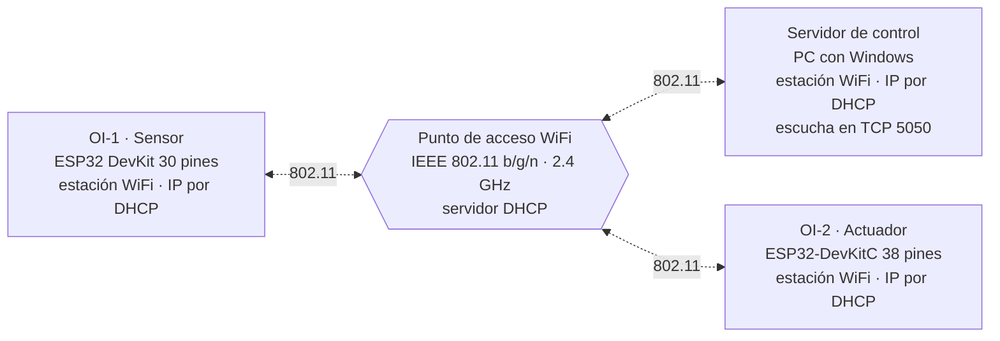

**Figura 2a.** Red física. Los tres nodos son estaciones del mismo punto de acceso, que les asigna la IP por DHCP. Todo mensaje entre dos nodos pasa por el punto de acceso. Las dos placas no tienen ningún cable en común: solo se comunican por WiFi.

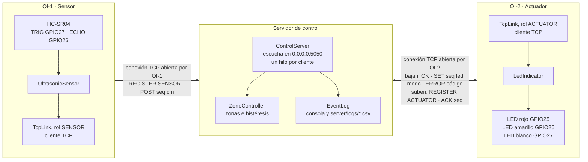

**Figura 2b.** Componentes y conexiones TCP. Los dos ESP32 abren su conexión hacia el puerto 5050 de la PC. Por la conexión de OI-1 suben las lecturas; por la de OI-2 bajan los comandos y suben las confirmaciones. El sensor y el actuador no se comunican entre sí: todo pasa por el servidor.

| Nodo | Hardware | Software | Rol TCP | Dirección y puerto | Alimentación | Registro de eventos |
|---|---|---|---|---|---|---|
| OI-1 Sensor | ESP32 DevKit de 30 pines + HC-SR04 | Firmware C++ (Arduino-ESP32 2.0.17), entorno `sensor` de PlatformIO | Cliente: inicia la conexión | IP por DHCP; puerto local efímero hacia `SERVER_HOST:5050` | USB 5 V (PC o power bank) | Monitor serie a 115200 baud, guardado con `log2file` |
| OI-2 Actuador | ESP32-DevKitC de 38 pines + 3 LEDs | Firmware C++ (Arduino-ESP32 2.0.17), entorno `actuator` | Cliente: inicia la conexión | IP por DHCP; puerto local efímero hacia `SERVER_HOST:5050` | USB 5 V (PC o power bank) | Monitor serie a 115200 baud, guardado con `log2file` |
| Servidor | PC con Windows 11 | [tcp_server.py](server/tcp_server.py), Python 3.10 o superior | Servidor: escucha | IP de la PC en la red local (DHCP); puerto 5050 en todas las interfaces | Propia de la PC | Consola y CSV en `server/logs/` |
| Punto de acceso | [PENDIENTE: equipo usado como punto de acceso, por ejemplo el hotspot de un celular] | — | — | Asigna las IP por DHCP | — | — |

#### Recorrido de una lectura por las capas TCP/IP

| Capa | En este sistema |
|---|---|
| Aplicación | Protocolo propio de texto, un mensaje por línea: `REGISTER`, `POST`, `SET`, `ACK`, `OK` y `ERROR` (§2.5). Lo implementan `TcpLink` en los ESP32 y `ControlServer` en la PC. |
| Transporte | TCP. El servidor escucha en el puerto 5050 y los clientes usan un puerto efímero. Hay una conexión persistente por cliente, con el algoritmo de Nagle desactivado en ambos extremos. |
| Internet | IPv4. El punto de acceso asigna las direcciones por DHCP. Los ESP32 conocen la IP del servidor por la constante `SERVER_HOST` de `Secrets.h`; el servidor muestra su propia IP al arrancar (evento `START`). |
| Acceso a la red | WiFi IEEE 802.11 b/g/n en 2.4 GHz, en modo infraestructura: los dos ESP32 y la PC son estaciones (STA) del mismo punto de acceso. El ahorro de energía del WiFi está desactivado en los ESP32. |

Recorrido del mensaje `POST 57 37.6`:

1. **Aplicación.** OI-1 termina una medición y arma la línea `POST 57 37.6` terminada en `\n`.
2. **Transporte.** TCP coloca la línea en un segmento dirigido al puerto 5050.
3. **Internet.** IP encapsula el segmento en un paquete con la IP de la PC como destino.
4. **Acceso a la red.** El ESP32 transmite la trama 802.11 al punto de acceso y este la retransmite a la PC. En modo infraestructura, cada mensaje entre dos estaciones cruza el aire dos veces.
5. **En la PC** cada capa quita su encabezado. TCP confirma los bytes con su propio ACK de transporte y entrega el flujo al servidor, que separa la línea en el `\n`.
6. Si la zona cambia, el `SET` hace el camino inverso hasta OI-2, y el `ACK` de aplicación vuelve al servidor por el mismo camino.

Hay dos confirmaciones distintas: el ACK de TCP solo indica que los bytes llegaron a la pila TCP del receptor; el `ACK` del protocolo indica que OI-2 ya aplicó el comando en sus LEDs.

#### Por qué TCP y una arquitectura cliente-servidor

- **TCP** entrega los mensajes completos y en orden, algo necesario para la histéresis y para contar lecturas inválidas seguidas. Además es orientado a conexión: el servidor sabe qué clientes están conectados y detecta cuándo uno se va. El algoritmo de Nagle se desactiva en los dos extremos para que los mensajes cortos salgan de inmediato.
- **Los ESP32 inician la conexión** porque obtienen su IP por DHCP; solo el servidor necesita una dirección conocida.
- **La lógica de control está en el servidor:** los rangos y la histéresis están en un solo lugar ([config.py](server/config.py)), se prueban con pruebas unitarias y el servidor ve todo el tráfico con un solo reloj, lo que permite medir la latencia.
- **El costo** es que el servidor es un punto único de falla. Se mitiga con el estado ERROR de OI-2 y con la reconexión automática de los clientes.

### 2.2 Diagramas de circuito

#### 2.2.1 OI-1 (sensor)

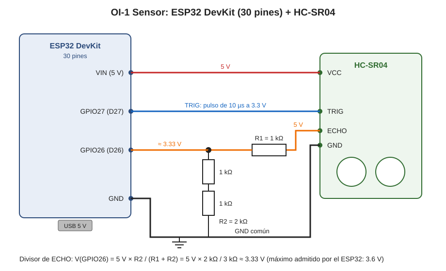

**Figura 3.** Esquema eléctrico de OI-1. El HC-SR04 se alimenta con 5 V desde el pin VIN, que recibe la tensión del USB. TRIG se conecta directo a GPIO27. ECHO entrega un pulso de 5 V, más de lo que admite un GPIO del ESP32, así que pasa por un divisor de tensión hecho con tres resistencias de 1 kΩ: una arriba (R1) y dos en serie abajo (R2 = 2 kΩ). El ESP32, el sensor y el divisor comparten la tierra.

| Pin del HC-SR04 | Conexión | Pin del ESP32 (30 pines) | Constante en el código |
|---|---|---|---|
| VCC | Directa | VIN (5 V del USB) | — |
| TRIG | Directa | GPIO27 (D27) | `SensorConfig::PIN_TRIG = 27` |
| ECHO | A través del divisor R1/R2 | GPIO26 (D26) | `SensorConfig::PIN_ECHO = 26` |
| GND | Directa | GND | — |

- **Divisor de ECHO:** V<sub>GPIO26</sub> = 5 V × R2 / (R1 + R2) = 5 V × 2 kΩ / 3 kΩ ≈ 3.33 V. Está por debajo del máximo del ESP32 (3.6 V) y por encima del umbral de nivel alto (≈ 2.48 V).
- **TRIG:** el HC-SR04 reconoce los 3.3 V del ESP32 como nivel alto.
- **Distancia:** d = t<sub>eco</sub> × 0.0343 cm/µs / 2, porque el sonido va hasta el objeto y vuelve. Por ejemplo, un eco de 1166 µs corresponde a 20.0 cm.

#### 2.2.2 OI-2 (actuador)

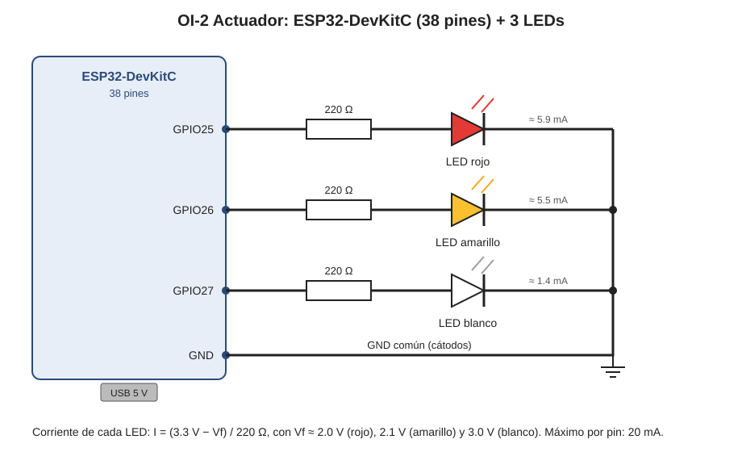

**Figura 4.** Esquema eléctrico de OI-2. Cada LED se conecta entre un GPIO y GND, en serie con una resistencia de 220 Ω que limita su corriente. El ánodo (pata larga) va hacia la resistencia y el cátodo (pata corta) a GND.

| LED | GPIO (DevKitC) | Constante en el código | Resistencia | Corriente estimada |
|---|---|---|---|---|
| Rojo | GPIO25 | `ActuatorConfig::PIN_LED_RED = 25` | 220 Ω | (3.3 − 2.0) / 220 ≈ 5.9 mA |
| Amarillo | GPIO26 | `ActuatorConfig::PIN_LED_YELLOW = 26` | 220 Ω | (3.3 − 2.1) / 220 ≈ 5.5 mA |
| Blanco | GPIO27 | `ActuatorConfig::PIN_LED_WHITE = 27` | 220 Ω | (3.3 − 3.0) / 220 ≈ 1.4 mA |

- **Corriente:** I = (3.3 V − V<sub>f</sub>) / 220 Ω, muy por debajo de los 20 mA recomendados por pin.
- **LED blanco:** su tensión directa (≈ 3.0 V) es cercana a 3.3 V, así que su corriente es baja y brilla menos. Es una consecuencia física, no una falla.

#### 2.2.3 Pines, alimentación y red

- **Pines:** los dos objetos usan solo GPIO 25, 26 y 27. No son pines de arranque (*strapping*: 0, 2, 5, 12 y 15), no están conectados a la memoria flash (6 a 11) y no son de solo entrada (34 a 39).
- **Placas:** las dos usan el mismo chip ESP32 y el código nombra los pines por su número de GPIO, así que en PlatformIO ambas usan `board = esp32dev`.
- **Alimentación:** cada placa se alimenta por su propio USB. No comparten tierra porque no hay cables entre ellas: solo se comunican por WiFi.
- **Red:** el ESP32 solo se conecta a redes de 2.4 GHz. La PC debe estar en la misma red y aceptar conexiones TCP entrantes en el puerto 5050 (§3.4).

### 2.3 Diagramas de clases

Hay un diagrama por programa y uno para la librería que comparten los dos firmwares. Notación: `+` es público, `-` es privado y los miembros subrayados son estáticos (constantes). «namespace» es un espacio de nombres de C++, «module» un módulo de Python y «main.cpp» el archivo principal de un firmware, con sus funciones `setup()` y `loop()`. El rombo lleno indica que un objeto crea y contiene al otro; el rombo vacío, que lo recibe ya creado; la flecha punteada, que lo usa.

#### 2.3.1 Librería compartida (`lib/`)

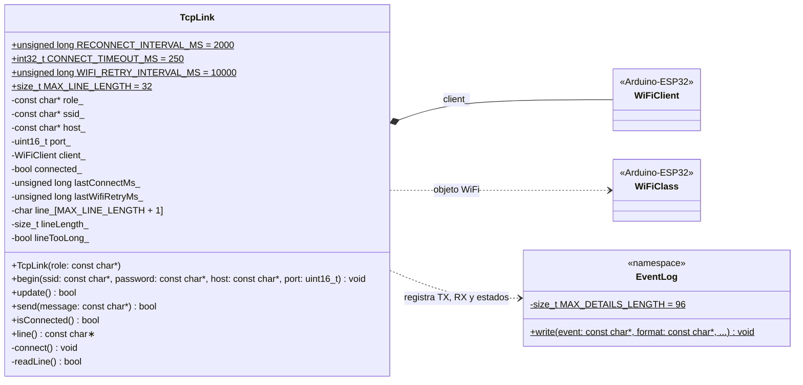

**Figura 5.** Clases de la librería compartida. `TcpLink` concentra toda la capa de red de los ESP32: es la única clase que usa `WiFi` y `WiFiClient`. Sus cuatro constantes públicas fijan los tiempos de reconexión y el tamaño máximo de un mensaje. `EventLog` es un namespace con una sola función, que escribe una línea de log con `t_ms` ([TcpLink.h](lib/TcpLink/TcpLink.h), [EventLog.h](lib/EventLog/EventLog.h)).

#### 2.3.2 OI-1: firmware del sensor

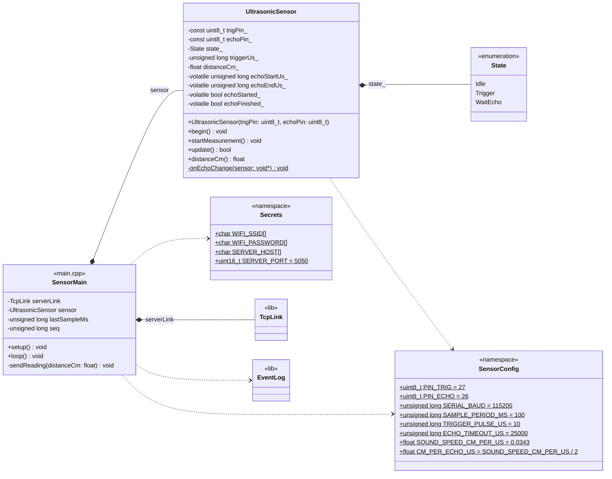

**Figura 6.** Clases de OI-1. `main.cpp` crea un `TcpLink` con el rol `SENSOR` y un `UltrasonicSensor` con los pines de `SensorConfig`. `UltrasonicSensor` tiene una máquina de estados interna (`State`, un `enum class` privado de la clase) y una función estática, `onEchoChange()`, que es la rutina de interrupción de ECHO. Los cuatro atributos `volatile` son los únicos que comparte con esa rutina ([UltrasonicSensor.h](src/sensor/UltrasonicSensor.h), [main.cpp](src/sensor/main.cpp)).

#### 2.3.3 OI-2: firmware del actuador

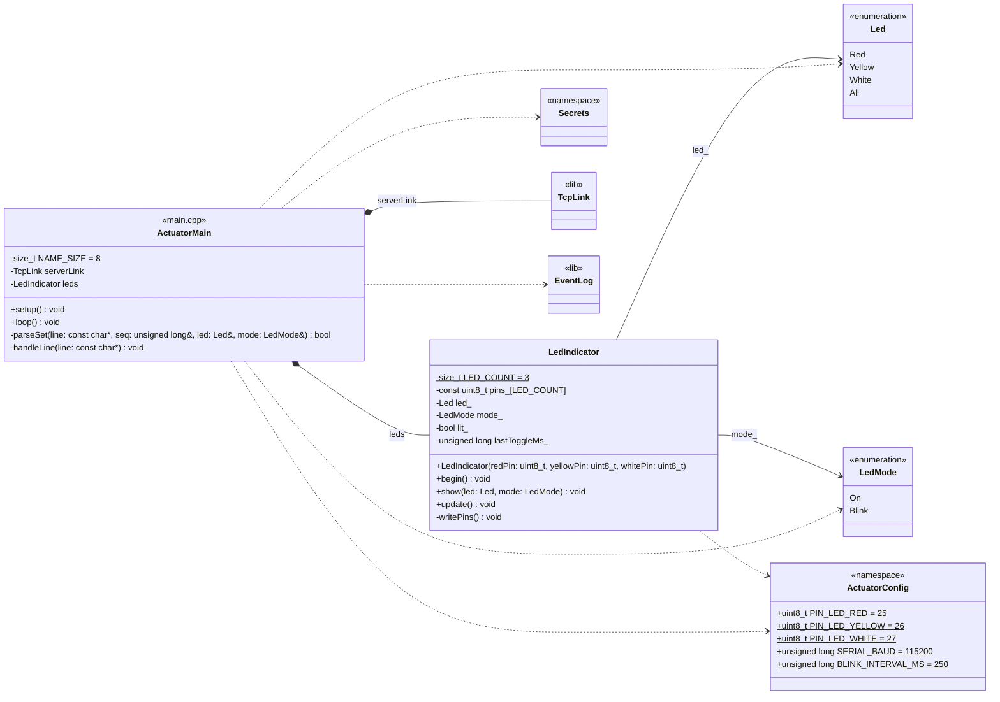

**Figura 7.** Clases de OI-2. `main.cpp` crea un `TcpLink` con el rol `ACTUATOR` y un `LedIndicator` con los pines de `ActuatorConfig`. `parseSet()` traduce los nombres del protocolo (`RED`, `BLINK`…) a los valores de `Led` y `LedMode`. `LedIndicator` guarda el estado que se muestra y la fase del parpadeo; el valor de cada color en `Led` es también la posición de su pin en `pins_` ([LedIndicator.h](src/actuator/LedIndicator.h), [main.cpp](src/actuator/main.cpp)). `Secrets` es el mismo namespace de la Figura 6.

#### 2.3.4 Servidor de control

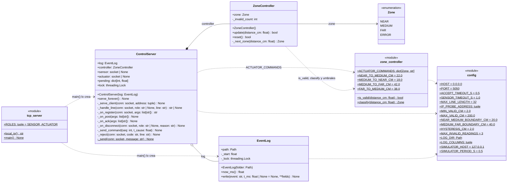

**Figura 8.** Clases del servidor. `ControlServer` es la entidad central de control: crea su `ZoneController` (composición) y recibe el `EventLog` que crea `main()` (agregación). `ZoneController` no tiene código de red ni de hardware: solo convierte lecturas en zonas, por eso se prueba de forma aislada. `EventLog` del servidor es una clase de Python distinta del `EventLog` de los ESP32, aunque cumple la misma función. Todas las constantes están en el módulo `config` ([tcp_server.py](server/tcp_server.py), [zone_controller.py](server/zone_controller.py), [config.py](server/config.py)).

### 2.4 Diagramas de secuencia

#### 2.4.1 Conexión y registro

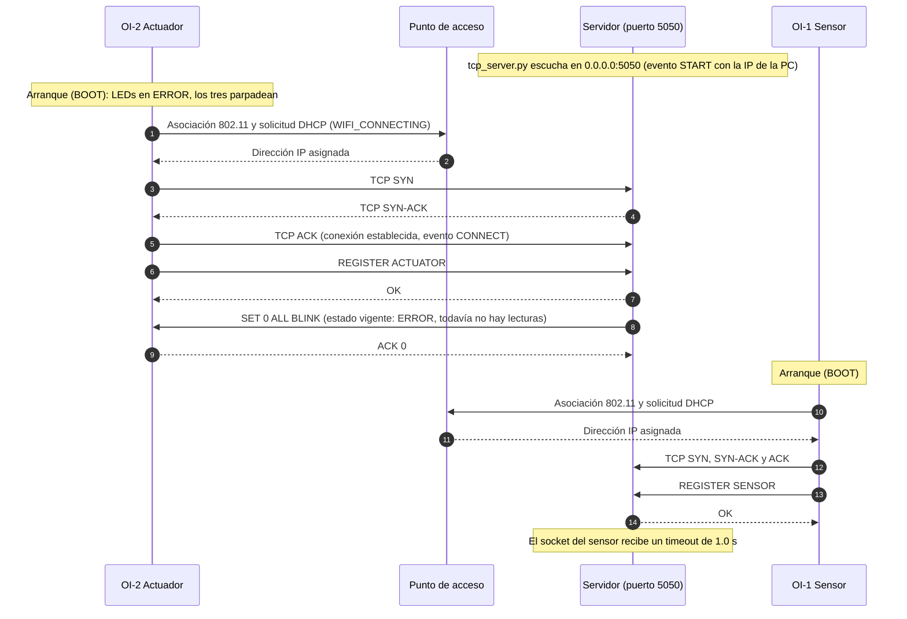

**Figura 9.** Conexión y registro de los dos clientes. Cada ESP32 se asocia al punto de acceso, obtiene su IP por DHCP, abre la conexión TCP con el handshake de tres vías y se registra. Al actuador el servidor le envía de inmediato el estado vigente. El orden de arranque es indistinto: aquí el actuador llega primero, por eso recibe ERROR (todavía no hay lecturas). Todos los mensajes TCP atraviesan el punto de acceso; en el diagrama solo se dibuja su participación en la asociación.

#### 2.4.2 Ciclo de medición y control

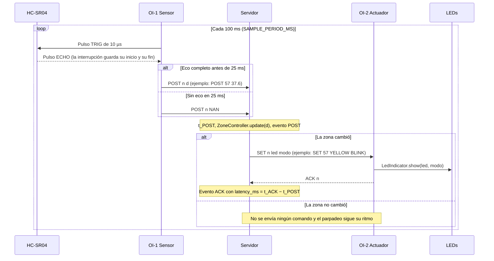

**Figura 10.** Ciclo normal. OI-1 mide cada 100 ms sin detenerse a esperar el eco y envía cada lectura, válida o no. El servidor ejecuta el algoritmo de control con cada `POST` y solo ordena algo a OI-2 cuando la zona cambia. OI-2 aplica el comando y responde con el mismo `seq`, lo que cierra la medición de latencia de ese cambio.

#### 2.4.3 Fallas y recuperación

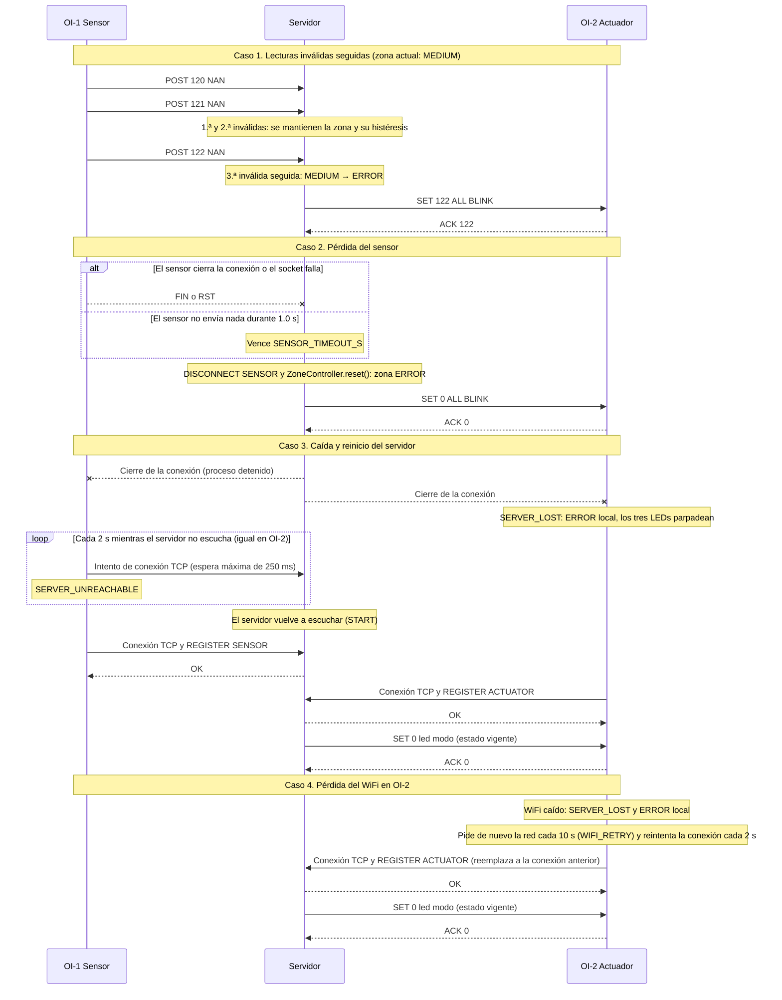

**Figura 11.** Casos alternativos. (1) Tres lecturas inválidas seguidas llevan a ERROR, con el `seq` de la tercera. (2) Si el sensor se va, por cierre o por silencio, el servidor ordena ERROR con `seq = 0`; si la zona ya era ERROR, no envía nada. (3) Si el servidor se detiene, OI-2 pasa a ERROR por sí mismo y los dos clientes reintentan cada 2 s hasta registrarse de nuevo. (4) Si OI-2 pierde el WiFi, muestra ERROR, se reconecta solo y recibe el estado vigente. El caso que esta versión no cubre, un servidor que desaparece sin cerrar las conexiones, está en §7.

### 2.5 Especificación del protocolo de aplicación

#### 2.5.1 Transporte y conexión

| Aspecto | Definición |
|---|---|
| Transporte | TCP sobre IPv4 |
| Servidor | Escucha en `0.0.0.0:5050`, es decir, en todas las interfaces de la PC. `PORT` de [config.py](server/config.py) y `SERVER_PORT` de `Secrets.h` deben coincidir |
| Iniciativa | OI-1 y OI-2 abren la conexión; el servidor nunca se conecta a los ESP32 |
| Duración | Persistente: una conexión por cliente, que dura mientras los dos extremos estén activos |
| Clientes | El servidor atiende cualquier número de conexiones (un hilo por conexión), pero solo hay un `SENSOR` y un `ACTUATOR` vigentes: un `REGISTER` con un rol ocupado reemplaza al cliente anterior |
| Opciones de socket | Algoritmo de Nagle desactivado: `TCP_NODELAY` en el servidor y `setNoDelay(true)` en los ESP32 |
| Detección de pérdida | Servidor: cierre o error del socket, y 1.0 s sin datos del sensor (`SENSOR_TIMEOUT_S`). Clientes: cierre detectado por `WiFiClient::connected()`, error de escritura o WiFi caído |

#### 2.5.2 Formato de los mensajes

- **Codificación:** texto ASCII, palabras clave en mayúsculas y campos separados por un espacio.
- **Fin de mensaje:** cada mensaje termina en `\n`. TCP entrega un flujo de bytes sin límites entre mensajes, así que cada receptor acumula bytes hasta encontrar el `\n`: en el servidor lo hace `conn.makefile()` y en los ESP32, `TcpLink::readLine()` (§3.6.4).
- **Longitud máxima:** 32 caracteres sin contar el `\n` (`MAX_LINE_LENGTH`, el mismo valor en [config.py](server/config.py) y en [TcpLink.h](lib/TcpLink/TcpLink.h)).
- **Números:** `seq` es un entero sin signo. La distancia se envía en cm con un decimal (`23.5`), o como `NAN` si la lectura es inválida.

| Mensaje | Sentido | Formato | Campos | Ejemplo literal | Respuesta |
|---|---|---|---|---|---|
| Registro | OI-1 → S y OI-2 → S | `REGISTER <rol>` | `rol`: `SENSOR` o `ACTUATOR` | `REGISTER SENSOR` | `OK`. Al actuador, además, `SET 0 …` con el estado vigente |
| Aceptación | S → OI-1 u OI-2 | `OK` | — | `OK` | Ninguna |
| Lectura | OI-1 → S | `POST <seq> <cm>` | `seq`: 1, 2, 3… (32 bits). `cm`: distancia en cm con un decimal, o `NAN` si el eco no terminó en 25 ms | `POST 57 23.5`, `POST 58 NAN` | Ninguna. Si la zona cambia, el servidor envía un `SET` a OI-2 |
| Comando | S → OI-2 | `SET <seq> <led> <modo>` | `seq`: el de la lectura que causó el cambio, o 0. `led`: `RED`, `YELLOW`, `WHITE` o `ALL`. `modo`: `ON` o `BLINK` | `SET 57 YELLOW BLINK` | `ACK <seq>` |
| Confirmación | OI-2 → S | `ACK <seq>` | `seq`: el del `SET` aplicado | `ACK 57` | Ninguna |
| Error | S → OI-1 u OI-2 | `ERROR <código>` | `código`: `BAD_FORMAT`, `NOT_REGISTERED` o `UNKNOWN_CMD` | `ERROR BAD_FORMAT` | Ninguna; el cliente solo lo registra |

- **Semántica de `SET`.** El LED indicado se activa en el modo indicado y los demás se apagan; `ALL` selecciona los tres. El servidor emite cuatro combinaciones: `RED BLINK` (NEAR), `YELLOW BLINK` (MEDIUM), `WHITE ON` (FAR) y `ALL BLINK` (ERROR). OI-2 acepta cualquier combinación de `led` y `modo`.
- **Distancia en `POST`.** OI-1 no filtra: envía el valor calculado aunque esté fuera de 2 a 200 cm. La validez la decide el servidor (RF6).

#### 2.5.3 Secuencia de los mensajes

1. Al abrir la conexión, el primer mensaje del cliente es `REGISTER`. Cualquier otro mensaje enviado antes recibe `ERROR NOT_REGISTERED`.
2. El servidor responde `OK`. Si el rol es `ACTUATOR`, envía a continuación `SET 0 <led> <modo>` con el estado vigente.
3. Los clientes no esperan el `OK` para continuar: TCP entrega los bytes en orden, así que el servidor procesa el `REGISTER` antes que cualquier `POST`.
4. OI-1 envía un `POST` por lectura, 10 por segundo, sin esperar respuesta.
5. El servidor envía `SET` solo en los casos de §2.5.5. OI-2 responde `ACK` con el mismo `seq` después de aplicar el comando.
6. Ningún mensaje de error cierra la conexión. Una conexión solo termina porque un extremo la cierra, por un error de red o por el timeout del sensor.
7. Un `REGISTER` nuevo con un rol ocupado reemplaza al cliente anterior; el servidor ignora la conexión vieja hasta que se cierra.

Los diagramas de §2.4 muestran estas secuencias con mensajes reales.

#### 2.5.4 Números de secuencia

- **Origen de `seq`.** Lo genera OI-1: empieza en 1 después de cada arranque y aumenta en 1 por lectura, aunque la lectura no se pueda enviar. Por eso:
  - un salto de `seq` en el CSV del servidor indica lecturas que no llegaron;
  - un `seq` menor que el anterior indica que OI-1 se reinició: vuelve a empezar en 1, pero las lecturas tomadas antes de conectarse no llegan al servidor.
- **Trazabilidad.** El servidor copia en el `SET` el `seq` del `POST` que provocó el cambio, y OI-2 lo devuelve en el `ACK`: la cadena `POST n` → `SET n` → `ACK n` se sigue en los logs de los tres nodos.
- **`seq = 0`.** Identifica los comandos que no provienen de una lectura: el estado que se envía al registrarse el actuador y el ERROR por pérdida del sensor.
- **Marcas de tiempo.** Los mensajes no llevan marcas de tiempo, porque los relojes de los nodos no están sincronizados. Cada nodo registra sus eventos con su propio `t_ms` (§3.8), y la latencia se calcula solo con el reloj del servidor: `latency_ms` = t(`ACK n`) − t(evento que causó `SET n`), columna `latency_ms` del CSV.

#### 2.5.5 Cuándo envía el servidor un comando

El servidor envía `SET` solo en tres casos: cuando la zona cambia, cuando se registra un actuador (estado vigente, `seq = 0`) y cuando se pierde el sensor (`SET 0 ALL BLINK`). No lo envía con cada lectura: así el parpadeo no se reinicia y cada `ACK` corresponde a un cambio real, lo que permite medir la latencia de cada transición.

#### 2.5.6 Manejo de errores

| Situación | Quién la detecta | Respuesta | Efecto en el sistema |
|---|---|---|---|
| Línea vacía o de más de 32 caracteres | Servidor | `ERROR BAD_FORMAT` | Evento `PROTOCOL_ERROR`; la conexión sigue abierta |
| Mensaje antes de `REGISTER` | Servidor | `ERROR NOT_REGISTERED` | Evento `PROTOCOL_ERROR`; la conexión sigue abierta |
| Rol desconocido, campos de más o de menos, número no válido | Servidor | `ERROR BAD_FORMAT` | Evento `PROTOCOL_ERROR`; la conexión sigue abierta |
| `POST` de un cliente que no es el sensor, `ACK` de uno que no es el actuador o comando desconocido | Servidor | `ERROR UNKNOWN_CMD` | Evento `PROTOCOL_ERROR`; la conexión sigue abierta |
| Lectura no finita o fuera de 2 a 200 cm | Servidor | Ninguna: no es un error de protocolo | Cuenta como lectura inválida (RF6) |
| `ACK` con un `seq` sin comando pendiente | Servidor | Ninguna | Se registra el `ACK` sin `latency_ms` |
| Línea de más de 32 caracteres recibida por un ESP32 | OI-1 u OI-2 | Se descarta | Evento `RX_TOO_LONG` |
| Línea que no es un `SET` válido recibida por OI-2 (`OK`, `ERROR` o `SET` mal formado) | OI-2 | Se ignora y no se responde `ACK` | Los LEDs no cambian |
| `ERROR` recibido por un cliente | OI-1 u OI-2 | Ninguna | Solo se registra (`RX`) |
| El sensor se desconecta o calla durante 1.0 s | Servidor | `SET 0 ALL BLINK` al actuador | `DISCONNECT SENSOR/closed`, `/timeout` o `/error`; zona ERROR |
| El actuador se desconecta | Servidor | Ninguna | `DISCONNECT ACTUATOR/…`; los comandos siguientes se registran como `NO_ACTUATOR` hasta que vuelva |
| Falla el envío de un `SET` | Servidor | Ninguna | `SEND_FAILED`; el actuador se da por perdido hasta que se registre de nuevo |
| Servidor caído o WiFi caído | OI-1 y OI-2 | Reintentos | `SERVER_LOST`; intento de conexión cada 2 s (`SERVER_UNREACHABLE` si falla) y pedido de WiFi cada 10 s (`WIFI_RETRY`); OI-2 muestra ERROR |

#### 2.5.7 Ejemplo de sesión real

Extracto del CSV del servidor de dos sesiones de la prueba A01 ([docs/evidencias/A01/](docs/evidencias/A01/)). La primera muestra el registro de los dos clientes; la segunda, dos cambios de zona con la histéresis.

Registro (`server_20261013_102843.csv`): OI-2 llega primero y recibe ERROR; OI-1 llega después y su primera lectura fija la zona.

```text
t_ms,event,seq,value,zone,latency_ms
1.1,START,,192.168.1.32:5050,,
3837.1,CONNECT,,192.168.1.55:62225,,
4024.2,REGISTER,,ACTUATOR,,
4024.9,SET,0,ALL BLINK,ERROR,
4498.3,ACK,0,,,473.4
82589.8,CONNECT,,192.168.1.54:51470,,
82590.8,REGISTER,,SENSOR,,
82591.3,POST,24,46.5,FAR,
82591.7,SET,24,WHITE ON,FAR,
82633.8,ACK,24,,,42.5
```

Cambios de zona (`server_20261013_103410.csv`): 20.8 cm no saca al sistema de NEAR y 23.2 cm sí (umbral de 22.0 cm); 41.9 cm no lo saca de MEDIUM y 44.8 cm sí (umbral de 42.0 cm). Cada `SET` lleva el `seq` del `POST` que lo causó y vuelve en el `ACK`, con su `latency_ms`.

```text
16099.9,POST,73,20.8,NEAR,
16201.5,POST,74,23.2,MEDIUM,
16202.2,SET,74,YELLOW BLINK,MEDIUM,
16264.1,ACK,74,,,62.6
...
18200.1,POST,94,41.9,MEDIUM,
18300.4,POST,95,44.8,FAR,
18301.1,SET,95,WHITE ON,FAR,
18323.9,ACK,95,,,23.5
```

El lado de OI-2 de la misma secuencia (`RX OK`, `RX SET 0 ALL BLINK`, `TX ACK 0`) se ve en la captura [A01-A_log_oi2.png](docs/evidencias/A01/A01-A_log_oi2.png).

---

## 3. Desarrollo e implementación

### 3.1 Entorno de desarrollo

| Elemento | OI-1 Sensor | OI-2 Actuador | Servidor |
|---|---|---|---|
| Herramienta | VS Code con PlatformIO IDE (PlatformIO Core 6.2.0) | Igual que OI-1 | Python 3.10 o superior (en el equipo de desarrollo, 3.13.7); cualquier terminal |
| Plataforma y framework | `espressif32` 7.0.1 con Arduino-ESP32 2.0.17 (paquete `framework-arduinoespressif32` 3.20017.241212) y compilador GCC 8.4.0 (`toolchain-xtensa-esp32`), estándar `gnu++11` | Igual que OI-1 | Solo la biblioteca estándar: `socket`, `threading`, `csv`, `enum`, `unittest`. No requiere paquetes externos |
| Placa | `board = esp32dev` (ESP32 DevKit de 30 pines) | `board = esp32dev` (ESP32-DevKitC de 38 pines) | PC con Windows 11 |
| Entorno de PlatformIO | `sensor`, que compila solo `src/sensor/` | `actuator`, que compila solo `src/actuator/` | — |
| Monitor | Serie a 115200 baud, filtros `default, log2file` | Igual que OI-1 | Consola, más el CSV de `server/logs/` |
| Ejecución | `pio run -e sensor -t upload` | `pio run -e actuator -t upload` | `python tcp_server.py`, desde `server/` |

Las versiones indicadas son las instaladas en el equipo con el que se compilaron los firmwares.

### 3.2 Estructura del repositorio

```text
SecondProject-IoT/
├── README.md                 Este informe
├── platformio.ini            Un proyecto de PlatformIO con dos entornos: sensor y actuator
├── .gitignore                Excluye compilados, credenciales, logs generados y archivos locales
├── .vscode/extensions.json   Extensión recomendada (PlatformIO IDE)
├── include/
│   └── Secrets.example.h     Plantilla de la configuración de red; Secrets.h no se versiona
├── lib/                      Código compartido por los dos firmwares
│   ├── EventLog/             Log por el monitor serie con t_ms
│   └── TcpLink/              Cliente WiFi/TCP con reconexión sin bloqueo y framing por líneas
├── src/
│   ├── sensor/               Firmware de OI-1
│   │   ├── SensorConfig.h
│   │   ├── UltrasonicSensor.h
│   │   ├── UltrasonicSensor.cpp
│   │   └── main.cpp
│   └── actuator/             Firmware de OI-2
│       ├── ActuatorConfig.h
│       ├── LedIndicator.h
│       ├── LedIndicator.cpp
│       └── main.cpp
├── server/                   Servidor de control (Python)
│   ├── config.py
│   ├── zone_controller.py
│   ├── tcp_server.py
│   ├── sensor_simulator.py
│   └── tests/                Pruebas y herramientas de prueba; se ejecutan desde server/ con -m
│       ├── test_zone_controller.py
│       ├── system_check.py
│       ├── client_check.py
│       └── analyze_log.py
└── docs/
    ├── img/                  Esquemas eléctricos de OI-1 y OI-2 (SVG)
    └── evidencias/           Evidencia de cada prueba de §4 (CSV, logs, salidas y videos)
```

Un solo proyecto de PlatformIO contiene los dos firmwares: la sección `[env]` común de [platformio.ini](platformio.ini) fija la plataforma, la placa, el framework y el monitor, y cada entorno compila solo su carpeta con `build_src_filter`. Los dos firmwares incluyen las librerías de `lib/` y el archivo `include/Secrets.h`.

### 3.3 Módulos y clases

| Nodo | Archivo | Clase o módulo | Responsabilidad |
|---|---|---|---|
| OI-1 y OI-2 | [TcpLink.h](lib/TcpLink/TcpLink.h), [TcpLink.cpp](lib/TcpLink/TcpLink.cpp) | `TcpLink` | Conexión WiFi y TCP, reconexión sin bloqueo, registro del rol, envío y recepción de líneas |
| OI-1 y OI-2 | [EventLog.h](lib/EventLog/EventLog.h), [EventLog.cpp](lib/EventLog/EventLog.cpp) | `EventLog` (namespace) | Una línea de log por evento, con `t_ms` |
| OI-1 y OI-2 | [Secrets.example.h](include/Secrets.example.h) | `Secrets` (namespace) | Plantilla del SSID, la clave, la IP y el puerto del servidor |
| OI-1 | [SensorConfig.h](src/sensor/SensorConfig.h) | `SensorConfig` (namespace) | Pines, período de muestreo, tiempos del HC-SR04 y velocidad del sonido |
| OI-1 | [UltrasonicSensor.h](src/sensor/UltrasonicSensor.h), [UltrasonicSensor.cpp](src/sensor/UltrasonicSensor.cpp) | `UltrasonicSensor` | Medición del HC-SR04 por interrupción, sin esperas |
| OI-1 | [main.cpp](src/sensor/main.cpp) | Programa del sensor | Coordina: mide cada 100 ms y envía un `POST` por lectura |
| OI-2 | [ActuatorConfig.h](src/actuator/ActuatorConfig.h) | `ActuatorConfig` (namespace) | Pines de los LEDs e intervalo de parpadeo |
| OI-2 | [LedIndicator.h](src/actuator/LedIndicator.h), [LedIndicator.cpp](src/actuator/LedIndicator.cpp) | `LedIndicator`, `Led`, `LedMode` | Estado de los tres LEDs y parpadeo sin bloqueo |
| OI-2 | [main.cpp](src/actuator/main.cpp) | Programa del actuador | Coordina: interpreta cada `SET`, lo aplica y responde `ACK`; sin conexión, muestra ERROR |
| Servidor | [config.py](server/config.py) | Módulo `config` | Todas las constantes del servidor y del simulador |
| Servidor | [zone_controller.py](server/zone_controller.py) | `Zone`, `ZoneController`, `classify()`, `is_valid()` | Algoritmo de control, sin código de red |
| Servidor | [tcp_server.py](server/tcp_server.py) | `ControlServer`, `EventLog`, `local_ip()` | Servidor TCP, validación del protocolo, envío de comandos y log CSV |
| Servidor | [test_zone_controller.py](server/tests/test_zone_controller.py) | 4 clases de prueba con 17 casos | Pruebas unitarias del algoritmo de control |
| Herramienta | [sensor_simulator.py](server/sensor_simulator.py) | Script | Sensor simulado que envía distancias exactas para probar las fronteras |
| Herramienta | [system_check.py](server/tests/system_check.py) | `Connection`, `ProtocolTest`, `ControlTest`, `DisconnectionTest` | Pruebas de sistema: un sensor y un actuador simulados comprueban por TCP cada respuesta del servidor |
| Herramienta | [client_check.py](server/tests/client_check.py) | `ActuatorCheck`, `SensorCheck` | Servidor de prueba que comprueba cómo responde el firmware de cada ESP32 |
| Herramienta | [analyze_log.py](server/tests/analyze_log.py) | Script | Calcula los valores medidos de los requerimientos a partir del CSV del servidor y de los logs de los ESP32 |

`main.cpp` y `tcp_server.main()` solo coordinan: crean los objetos y llaman a sus métodos. La lógica de cada responsabilidad está en su propia clase.

### 3.4 Configuración de red y credenciales

1. Copiar [include/Secrets.example.h](include/Secrets.example.h) como `include/Secrets.h` y completar:
   - `WIFI_SSID` y `WIFI_PASSWORD`: la red WiFi de 2.4 GHz;
   - `SERVER_HOST`: la IP de la PC en esa red, que el servidor muestra al arrancar en el evento `START`;
   - `SERVER_PORT`: 5050, el mismo valor que `PORT` en [config.py](server/config.py).
2. `include/Secrets.h` está en [.gitignore](.gitignore): las credenciales nunca se suben al repositorio. Solo se versiona la plantilla.
3. Windows debe tener la red configurada como privada y una regla de entrada para el puerto 5050. Por ejemplo, desde una consola de PowerShell abierta como administrador:

   ```powershell
   New-NetFirewallRule -DisplayName "SIS-234 servidor TCP 5050" -Direction Inbound -Protocol TCP -LocalPort 5050 -Action Allow -Profile Private
   ```

4. Si la IP de la PC cambia, hay que actualizar `SERVER_HOST` y volver a cargar los dos firmwares.

### 3.5 Compilación, carga y ejecución

Servidor, desde la carpeta `server/`:

```bash
python -m unittest -v              # pruebas unitarias del algoritmo de control
python tcp_server.py               # inicia el servidor; Ctrl+C lo detiene
python sensor_simulator.py         # opcional: sensor simulado con el escenario de fronteras
python sensor_simulator.py 10.0 25.0 NAN   # opcional: valores propios, en orden
python -m tests.system_check                 # pruebas de sistema con sensor y actuador simulados (servidor en marcha)
python -m tests.client_check ActuatorCheck   # servidor de prueba para OI-2 (servidor real detenido)
python -m tests.client_check SensorCheck     # servidor de prueba para OI-1 (servidor real detenido)
python -m tests.analyze_log                  # mide los requerimientos con el CSV más reciente
```

Firmwares, desde la raíz del proyecto:

```bash
pio run -e sensor -t upload        # compila y carga OI-1
pio run -e actuator -t upload      # compila y carga OI-2
pio device monitor -e sensor       # monitor serie de OI-1; la sesión se guarda en un .log
pio device monitor -e actuator     # monitor serie de OI-2
```

Con las dos placas conectadas a la vez, hay que descomentar en [platformio.ini](platformio.ini) las líneas `upload_port` y `monitor_port` de cada entorno con el puerto COM de cada placa. Conviene arrancar primero el servidor, aunque el orden no es obligatorio porque los clientes reintentan la conexión.

### 3.6 Fragmentos clave

Los fragmentos son extractos cortos; el código completo está en los archivos enlazados.

#### 3.6.1 Conexión y reconexión sin bloqueo (OI-1 y OI-2)

`TcpLink::update()` se llama en cada `loop()` y vuelve de inmediato. Si se perdió el WiFi o el servidor cerró la conexión, libera el socket; si no hay conexión, intenta conectarse una vez cada 2 s, midiendo el tiempo con `millis()` ([TcpLink.cpp, líneas 41 a 60](lib/TcpLink/TcpLink.cpp#L41-L60)):

```cpp
  if (connected_ && !(wifiConnected && client_.connected())) {
    connected_ = false;
    client_.stop();
    EventLog::write("SERVER_LOST", "wifi=%s", wifiConnected ? "up" : "down");
  }

  if (connected_) {
    return readLine();
  }

  if (wifiConnected && now - lastConnectMs_ >= RECONNECT_INTERVAL_MS) {
    lastConnectMs_ = now;
    connect();
  }
  return false;
```

`connect()` es la única espera del firmware: como máximo 250 ms, y solo si el servidor no responde. Al conectarse desactiva el algoritmo de Nagle y envía el registro con el rol del nodo ([TcpLink.cpp, líneas 77 a 98](lib/TcpLink/TcpLink.cpp#L77-L98)):

```cpp
  if (!client_.connect(host_, port_, CONNECT_TIMEOUT_MS)) {
    EventLog::write("SERVER_UNREACHABLE", "server=%s:%u", host_, port_);
    return;
  }
  client_.setNoDelay(true);
  connected_ = true;
  // ...
  snprintf(message, sizeof(message), "REGISTER %s", role_);
  send(message);
```

#### 3.6.2 Muestreo y envío de cada lectura (OI-1)

El `loop()` del sensor inicia una medición cada 100 ms y envía el resultado apenas está listo ([sensor/main.cpp, líneas 56 a 71](src/sensor/main.cpp#L56-L71)). `sendReading()` numera la lectura y arma el `POST` con un decimal, o con `NAN` si no hubo eco ([sensor/main.cpp, líneas 24 a 36](src/sensor/main.cpp#L24-L36)):

```cpp
  seq++;
  if (std::isnan(distanceCm)) {
    snprintf(message, sizeof(message), "POST %lu NAN", seq);
  } else {
    snprintf(message, sizeof(message), "POST %lu %.1f", seq, distanceCm);
  }
  serverLink.send(message);
```

`seq` aumenta aunque no haya conexión. Así, la lectura igual aparece en el log de OI-1 como `TX_FAILED`, y en el servidor queda un salto de `seq` que delata las lecturas perdidas.

#### 3.6.3 Medición del eco por interrupción (OI-1)

La rutina de interrupción se ejecuta en los dos flancos de ECHO y solo guarda sus tiempos. El flanco de bajada cuenta únicamente si se vio el de subida del mismo eco, así se descarta el final de un eco viejo. Las variables que comparte con el programa son `volatile` y la rutina está en la RAM interna (`IRAM_ATTR`) ([UltrasonicSensor.cpp, líneas 66 a 82](src/sensor/UltrasonicSensor.cpp#L66-L82)):

```cpp
void IRAM_ATTR UltrasonicSensor::onEchoChange(void *sensor) {
  auto *self = static_cast<UltrasonicSensor *>(sensor);
  const unsigned long nowUs = micros();
  if (digitalRead(self->echoPin_) == HIGH) {
    self->echoStartUs_ = nowUs;
    self->echoStarted_ = true;
  } else if (self->echoStarted_) {
    self->echoEndUs_ = nowUs;
    self->echoFinished_ = true;
  }
}
```

`update()` calcula la distancia cuando la interrupción marcó el fin del eco, o devuelve `NAN` si pasaron 25 ms sin eco completo ([UltrasonicSensor.cpp, líneas 32 a 62](src/sensor/UltrasonicSensor.cpp#L32-L62)):

```cpp
  if (echoFinished_) {
    distanceCm_ = static_cast<float>(echoEndUs_ - echoStartUs_) * SensorConfig::CM_PER_ECHO_US;
  } else if (elapsedUs >= SensorConfig::ECHO_TIMEOUT_US) {
    distanceCm_ = NAN;
  } else {
    return false;
  }
```

El pulso TRIG de 10 µs también se mide con `micros()` dentro de `update()`: el firmware no usa `delayMicroseconds()` ni `pulseIn()`.

#### 3.6.4 Recepción por líneas en los ESP32 (framing)

`readLine()` lee solo los bytes que ya llegaron (`available()`), así que nunca espera. Arma la línea hasta el `\n`, devuelve la primera línea completa y deja los bytes siguientes para la próxima llamada. Una línea de más de 32 caracteres se descarta completa ([TcpLink.cpp, líneas 100 a 125](lib/TcpLink/TcpLink.cpp#L100-L125)):

```cpp
  while (client_.available() > 0) {
    const char c = static_cast<char>(client_.read());
    if (c == '\n') {
      const bool complete = !lineTooLong_;
      line_[lineLength_] = '\0';
      lineLength_ = 0;
      lineTooLong_ = false;
      EventLog::write(complete ? "RX" : "RX_TOO_LONG", "%s", line_);
      if (complete) {
        return true;
      }
    } else if (lineLength_ < MAX_LINE_LENGTH) {
      line_[lineLength_++] = c;
    } else {
      lineTooLong_ = true;
    }
  }
  return false;
```

#### 3.6.5 Concurrencia del servidor

Leer un socket bloquea, así que el servidor atiende cada cliente en su propio hilo. `accept()` vuelve cada 0.5 s para que Ctrl+C pueda detener el servidor en Windows, y cada conexión aceptada desactiva Nagle ([tcp_server.py, líneas 91 a 105](server/tcp_server.py#L91-L105)):

```python
        with socket.create_server((config.HOST, config.PORT)) as listener:
            listener.settimeout(config.ACCEPT_TIMEOUT_S)
            self.log.write("START", value=f"{local_ip()}:{config.PORT}")
            while True:
                try:
                    conn, address = listener.accept()
                except TimeoutError:
                    continue
                conn.setsockopt(socket.IPPROTO_TCP, socket.TCP_NODELAY, 1)
                threading.Thread(target=self._serve_client,
                                 args=(conn, address), daemon=True).start()
```

Los hilos comparten el controlador, los sockets del sensor y del actuador y los comandos pendientes. Cada método que toca ese estado lo hace dentro de `with self.lock:`, un único `threading.Lock`, de modo que dos lecturas o un `POST` y un `ACK` nunca se procesan a la vez.

#### 3.6.6 Recepción, framing y validación en el servidor

`makefile()` convierte el flujo de bytes en líneas terminadas en `\n` ([tcp_server.py, líneas 107 a 121](server/tcp_server.py#L107-L121)). `_handle_line()` valida cada línea antes de despacharla. El rol es una variable local del hilo de cada conexión, y los errores de argumentos (faltantes, sobrantes o no numéricos) llegan como `ValueError` ([tcp_server.py, líneas 123 a 150](server/tcp_server.py#L123-L150)):

```python
        parts = line.split()
        if not parts or len(line) > config.MAX_LINE_LENGTH:
            self._reject(conn, "BAD_FORMAT", line)
            return role
        command, args = parts[0], parts[1:]
        try:
            if command == "REGISTER":
                return self._on_register(conn, args)
            if role is None:
                self._reject(conn, "NOT_REGISTERED", line)
            elif command == "POST" and role == "SENSOR":
                self._on_post(args)
            elif command == "ACK" and role == "ACTUATOR":
                self._on_ack(args)
            else:
                self._reject(conn, "UNKNOWN_CMD", line)
        except ValueError:
            self._reject(conn, "BAD_FORMAT", line)
        return role
```

#### 3.6.7 Algoritmo de control

`update()` procesa una lectura y devuelve `True` solo si la zona cambió ([zone_controller.py, líneas 73 a 88](server/zone_controller.py#L73-L88)):

```python
        if is_valid(distance_cm):
            self._invalid_count = 0
            new_zone = self._next_zone(distance_cm)
        else:
            self._invalid_count += 1
            if self._invalid_count < config.MAX_INVALID_READINGS:
                return False
            new_zone = Zone.ERROR
        changed = new_zone != self.zone
        self.zone = new_zone
        return changed
```

`_next_zone()` implementa la Tabla 2: cada zona se abandona solo por sus propios umbrales. Por ejemplo, desde NEAR ([zone_controller.py, líneas 100 a 127](server/zone_controller.py#L100-L127)):

```python
        if self.zone == Zone.NEAR:
            if distance_cm >= MEDIUM_TO_FAR_CM:
                return Zone.FAR
            if distance_cm >= NEAR_TO_MEDIUM_CM:
                return Zone.MEDIUM
            return Zone.NEAR
```

#### 3.6.8 Envío del comando y medición de la latencia

`_on_post()` toma `t_post`, ejecuta el algoritmo, registra la lectura y, si la zona cambió, envía el comando con el `seq` de esa lectura ([tcp_server.py, líneas 174 a 186](server/tcp_server.py#L174-L186)):

```python
        with self.lock:
            t_post = self.log.now_ms()
            changed = self.controller.update(distance)
            self.log.write("POST", t_post, seq=seq, value=distance_text,
                           zone=self.controller.zone.name)
            if changed:
                self._send_command(seq, t_post)
```

`_send_command()` envía `SET <seq> <comando>` y guarda en `pending` el instante que lo causó ([tcp_server.py, líneas 216 a 237](server/tcp_server.py#L216-L237)). Cuando llega el `ACK`, `_on_ack()` calcula la latencia con el mismo reloj ([tcp_server.py, líneas 188 a 200](server/tcp_server.py#L188-L200)):

```python
            t_ack = self.log.now_ms()
            t_cause = self.pending.pop(seq, None)
            latency = "" if t_cause is None else round(t_ack - t_cause, 1)
            self.log.write("ACK", t_ack, seq=seq, latency_ms=latency)
```

El evento `POST` se escribe en la consola y en el CSV antes de enviar el `SET`, así que el tiempo de ese registro forma parte de T<sub>proc</sub> y queda incluido en `latency_ms`.

#### 3.6.9 Aplicación del comando en OI-2

`parseSet()` lee los tres campos con `sscanf("SET %lu %7s %7s", ...)`; el ancho `%7s` impide escribir más allá de los buffers de 8 bytes (`NAME_SIZE`). Después compara los nombres con `strcmp` y los traduce a `Led` y `LedMode` ([actuator/main.cpp, líneas 29 a 59](src/actuator/main.cpp#L29-L59)). `handleLine()` aplica el comando y recién entonces envía el `ACK` ([actuator/main.cpp, líneas 63 a 77](src/actuator/main.cpp#L63-L77)):

```cpp
  if (!parseSet(line, seq, led, mode)) {
    return;
  }
  leds.show(led, mode);

  char ack[TcpLink::MAX_LINE_LENGTH + 1];
  snprintf(ack, sizeof(ack), "ACK %lu", seq);
  serverLink.send(ack);
```

#### 3.6.10 Parpadeo sin bloqueo y falla segura local (OI-2)

`show()` ignora un estado repetido, así el parpadeo conserva su ritmo; un estado nuevo se muestra de inmediato, empezando con el LED encendido. `update()` invierte la fase cada 250 ms usando `millis()` ([LedIndicator.cpp, líneas 22 a 46](src/actuator/LedIndicator.cpp#L22-L46)):

```cpp
void LedIndicator::show(Led led, LedMode mode) {
  if (led == led_ && mode == mode_) {
    return;
  }
  led_ = led;
  mode_ = mode;
  lit_ = true;
  lastToggleMs_ = millis();
  writePins();
}

void LedIndicator::update() {
  const unsigned long now = millis();
  if (mode_ == LedMode::Blink && now - lastToggleMs_ >= ActuatorConfig::BLINK_INTERVAL_MS) {
    lastToggleMs_ = now;
    lit_ = !lit_;
    writePins();
  }
}
```

El `loop()` de OI-2 atiende las líneas del servidor y, si no hay conexión, muestra ERROR por sí mismo ([actuator/main.cpp, líneas 99 a 112](src/actuator/main.cpp#L99-L112)):

```cpp
void loop() {
  if (serverLink.update()) {
    handleLine(serverLink.line());
  }
  if (!serverLink.isConnected()) {
    leds.show(Led::All, LedMode::Blink);
  }
  leds.update();
}
```

### 3.7 Temporización sin bloqueos

| Constante | Valor | Archivo | Uso |
|---|---|---|---|
| `SAMPLE_PERIOD_MS` | 100 ms | [SensorConfig.h](src/sensor/SensorConfig.h) | Una medición cada 100 ms (10 lecturas/s). La hoja de datos del HC-SR04 recomienda al menos 60 ms entre disparos |
| `TRIGGER_PULSE_US` | 10 µs | [SensorConfig.h](src/sensor/SensorConfig.h) | Duración del pulso TRIG |
| `ECHO_TIMEOUT_US` | 25 000 µs | [SensorConfig.h](src/sensor/SensorConfig.h) | Espera máxima del eco. El eco de un objeto a 400 cm, el alcance de la hoja de datos del HC-SR04, dura 2 × 400 / 0.0343 ≈ 23 300 µs |
| `BLINK_INTERVAL_MS` | 250 ms | [ActuatorConfig.h](src/actuator/ActuatorConfig.h) | Medio período del parpadeo (2 Hz) |
| `RECONNECT_INTERVAL_MS` | 2000 ms | [TcpLink.h](lib/TcpLink/TcpLink.h) | Separación entre intentos de conexión al servidor |
| `CONNECT_TIMEOUT_MS` | 250 ms | [TcpLink.h](lib/TcpLink/TcpLink.h) | Espera máxima de un intento de conexión |
| `WIFI_RETRY_INTERVAL_MS` | 10 000 ms | [TcpLink.h](lib/TcpLink/TcpLink.h) | Tiempo sin WiFi tras el cual se vuelve a pedir la conexión a la red |
| `SENSOR_TIMEOUT_S` | 1.0 s | [config.py](server/config.py) | Silencio máximo del sensor antes de darlo por perdido |
| `ACCEPT_TIMEOUT_S` | 0.5 s | [config.py](server/config.py) | Período con que vuelve `accept()`, para poder detener el servidor con Ctrl+C |
| `SIMULATOR_PERIOD_S` | 0.5 s | [config.py](server/config.py) | Período del sensor simulado; es menor que `SENSOR_TIMEOUT_S` |

- **Sin `delay()`.** Ningún firmware usa `delay()`, `delayMicroseconds()` ni `pulseIn()`. Cada tarea periódica compara el tiempo transcurrido con su intervalo y vuelve de inmediato si todavía no corresponde actuar.
- **Resta sin signo.** Todas las comparaciones usan la forma `now - last >= INTERVAL` con variables `unsigned long`. La resta sin signo da el tiempo transcurrido correcto aunque el contador se desborde: `millis()` vuelve a 0 cada 2<sup>32</sup> ms ≈ 49.7 días y `micros()`, cada 2<sup>32</sup> µs ≈ 71.6 min.
- **Única espera acotada.** `client_.connect()` espera como máximo 250 ms, y solo mientras el servidor no responde. Si la PC rechaza la conexión porque el puerto está cerrado, el intento falla enseguida; si el firewall descarta los paquetes en silencio, dura los 250 ms completos. En ese caso, en OI-2 una de cada ocho inversiones del parpadeo de ERROR (2 s / 250 ms = 8) puede alargarse hasta unos 500 ms.
- **Tiempo de adquisición.** Desde que el objeto llega a una posición hasta que sale el `POST` pasan como máximo 100 ms (la espera hasta la siguiente medición) más la duración del eco: unos 2.4 ms a 42 cm y 25 ms en el peor caso.

### 3.8 Registro de eventos (logs)

Los logs son la base para medir los requerimientos no funcionales. Cada nodo usa su propio reloj, y solo se restan tiempos de un mismo nodo.

**ESP32 (OI-1 y OI-2).** [EventLog.cpp](lib/EventLog/EventLog.cpp#L19-L33) imprime en el monitor serie una línea por evento, con el formato `[t_ms=%9lu] %-18s %s`. `t_ms` son los milisegundos desde el arranque de la placa (`millis()`), seguidos del nombre del evento y de sus detalles (96 caracteres como máximo). El filtro `log2file` de PlatformIO guarda cada sesión del monitor en un archivo `platformio-device-monitor-*.log`.

| Evento | Detalles | Cuándo ocurre |
|---|---|---|
| `BOOT` | Rol, pines y, en OI-1, el período de muestreo | Al arrancar. Un `BOOT` nuevo en medio de una prueba indica un reinicio |
| `WIFI_CONNECTING` | `ssid` | Al iniciar la conexión WiFi |
| `WIFI_RETRY` | `ssid` | Tras 10 s sin WiFi |
| `SERVER_CONNECTED` | `server`, `local_ip` | Conexión TCP establecida |
| `SERVER_UNREACHABLE` | `server` | Intento de conexión fallido |
| `SERVER_LOST` | `wifi=up` o `wifi=down` | Pérdida de la conexión con el servidor |
| `TX` y `TX_FAILED` | El mensaje | Mensaje enviado, o mensaje que no se pudo enviar |
| `RX` y `RX_TOO_LONG` | La línea recibida | Línea completa, o línea de más de 32 caracteres descartada |

**Servidor.** La clase `EventLog` de [tcp_server.py](server/tcp_server.py#L33-L71) escribe cada evento en la consola, con el formato `[t_ms=%9.1f] %-14s campo=valor …`, y en el archivo `server/logs/server_AAAAMMDD_HHMMSS.csv`, con las columnas `t_ms, event, seq, value, zone, latency_ms`. `t_ms` son los milisegundos desde el arranque del servidor, medidos con `time.perf_counter()` (un reloj monotónico de alta resolución) y redondeados a 0.1 ms. El archivo se abre y se cierra en cada evento, así que ningún evento se pierde si el programa termina de golpe, y un lock ordena las escrituras de los distintos hilos.

| Evento | `seq` | `value` | `zone` | `latency_ms` |
|---|---|---|---|---|
| `START` | — | IP y puerto del servidor | — | — |
| `CONNECT` | — | IP y puerto del cliente | — | — |
| `REGISTER` | — | Rol | — | — |
| `POST` | `seq` de la lectura | Distancia tal como llegó | Zona después de procesarla | — |
| `SET` | `seq` del comando | Comando | Zona | — |
| `ACK` | `seq` confirmado | — | — | t(`ACK`) − t(causa), en ms |
| `NO_ACTUATOR` | `seq` | Comando que no se pudo enviar | Zona | — |
| `SEND_FAILED` | `seq` | Comando | — | — |
| `PROTOCOL_ERROR` | — | Código y línea recibida | — | — |
| `DISCONNECT` | — | Rol y motivo (`closed`, `timeout` o `error`) | — | — |
| `STOP` | — | — | — | — |

Uso de los logs en las mediciones:

| Requerimiento | Dato que se obtiene de los logs |
|---|---|
| RNF1 Estabilidad | `seq` (reinicios y lecturas perdidas), `DISCONNECT` (desconexiones) e intervalos entre eventos `POST` (bloqueos); `BOOT` en los logs de los ESP32 |
| RNF3 Tiempo de respuesta | Columna `latency_ms` de cada `ACK` con `seq` > 0 |
| RNF4 Frecuencia | Eventos `POST` del CSV por ventana de 10 s |
| RNF5 Reconexión | Diferencia entre `START` y cada `REGISTER` en el CSV |

[analyze_log.py](server/tests/analyze_log.py) calcula todos estos valores a partir del CSV y de los logs de los ESP32 (§4).

### 3.9 Buenas prácticas aplicadas

- **Programación orientada a objetos.** Cada responsabilidad está en una clase: `UltrasonicSensor`, `LedIndicator`, `TcpLink`, `ZoneController`, `ControlServer` y `EventLog`. Los archivos principales solo crean los objetos y los coordinan.
- **Modularidad.** La librería `lib/` se escribe una sola vez y la usan los dos firmwares. En el servidor, la configuración, el algoritmo de control (sin código de red), el servidor TCP, las pruebas y el simulador están en módulos separados.
- **Sin números mágicos.** Los pines, los umbrales, los tiempos y los tamaños son constantes con nombre, definidas una sola vez: `constexpr` dentro de un namespace en C++ y constantes de módulo en Python. Los umbrales de las zonas existen solo en el servidor.
- **Sin bloqueos.** No hay `delay()` ni `pulseIn()`; el eco se mide por interrupción y todos los tiempos se controlan con `millis()` y `micros()`.
- **Convenciones de C++.** Estándar C++11 (`gnu++11`, el de Arduino-ESP32 2.x); formato al estilo de la guía de Google (sangría de 2 espacios, `public:` y `private:` con un espacio, dos espacios antes de los comentarios de línea, líneas de 100 columnas como máximo); nombres al estilo de las bibliotecas de Arduino: clases en PascalCase, métodos y variables en camelCase, miembros privados con `_` final y constantes en MAYÚSCULAS. Se usan `enum class`, `static_cast`, `constexpr`, constructores `explicit`, métodos `const` y guardas de inclusión.
- **Convenciones de Python.** PEP 8 (79 columnas como máximo), docstrings PEP 257 en cada módulo, clase y función, y anotaciones de tipo. Funciones y variables en snake_case, clases en PascalCase, constantes en MAYÚSCULAS y métodos internos con `_` inicial.
- **Documentación en el código.** Cada `.h` explica el contrato de sus métodos públicos: qué hacen, en qué unidades trabajan y qué devuelven ante un error. Por ejemplo, `distanceCm()` devuelve centímetros o `NAN`, y `send()` devuelve `false` si el mensaje no salió. En el servidor, los docstrings cumplen la misma función. Los comentarios, los nombres y los logs están en inglés; el informe, en español.
- **Pruebas.** El algoritmo de control tiene 17 pruebas unitarias con los valores exactos de las fronteras. `system_check.py` prueba el servidor completo por TCP con un sensor y un actuador simulados, `client_check.py` prueba el firmware de cada ESP32 con un servidor de prueba y `analyze_log.py` calcula los requerimientos a partir de los logs.
- **Control de versiones.** Commits pequeños con prefijos convencionales (`feat`, `fix`, `docs`, `style`, `test`, `chore`), hechos por cada integrante desde su propia cuenta.
- **Seguridad de las credenciales.** `Secrets.h` no se versiona; solo se sube la plantilla `Secrets.example.h`.

### 3.10 Cobertura de los requerimientos

Cada requerimiento de §1 está implementado en los archivos que indica la matriz de §1.6. La única capacidad que el diseño no tiene es la detección, en OI-2, de un servidor que desaparece sin cerrar la conexión; está declarada como limitación en §7.

---

## 4. Pruebas y validaciones

El plan verifica cada requerimiento de §1 con al menos una prueba, según la matriz de §1.6. Cada criterio de éxito sale de un valor declarado en §1 o de una constante del código, así el veredicto no depende de una apreciación subjetiva. Las pruebas se dividen en dos categorías, según cómo se obtiene el veredicto:

- **A. Físicas y de entorno (manuales).** Requieren actuar sobre el montaje o sobre la red: colocar un objeto a una distancia medida con regla, desconectar un cable o una fuente, apagar el punto de acceso o grabar video. Los tiempos y las distancias se calculan a partir de los logs con [analyze_log.py](server/tests/analyze_log.py); el video registra lo que se ve en los LEDs.
- **B. Sistema y logs (automáticas).** El veredicto se obtiene solo con software: las pruebas unitarias, las pruebas de sistema con un sensor y un actuador simulados ([system_check.py](server/tests/system_check.py)), el servidor de prueba que verifica el firmware de los ESP32 ([client_check.py](server/tests/client_check.py)) y el análisis de los logs con [analyze_log.py](server/tests/analyze_log.py). Incluyen las desconexiones que se pueden provocar desde la computadora: un cliente que cierra la conexión, que la corta, que deja de enviar, que es reemplazado o que no está, y un servidor que se detiene.

El identificador indica la categoría: A01 a A08 son pruebas físicas (§4.2) y B01 a B07, automáticas (§4.3).

### 4.1 Plan de Pruebas

**A. Pruebas físicas y de entorno**

| ID | Prueba | Qué se verifica | Requisitos | Duración aprox. |
|---|---|---|---|---|
| A01 | Arranque y funcionamiento por zona | Registro de OI-2 sin sensor, cada zona con su LED y el parpadeo de 2 Hz | RF1, RF2, RF3, RF4 | 10 min |
| A02 | Exactitud de la distancia | Error de 10 lecturas en 7 distancias de 5 a 100 cm | RF1, RNF2 | 10 min |
| A03 | Límites del rango de medición | Lecturas a 2, 150, 190 y 200 cm; objeto en la zona ciega, más allá de 200 cm y sin eco | RF1, RF2, RF6 | 15 min |
| A04 | Histéresis con el sensor real | Objeto quieto en cada frontera y cruce lento en ambos sentidos | RF5 | 10 min |
| A05 | Tiempo de respuesta extremo a extremo | Al menos 10 cambios FAR ↔ NEAR y 10 FAR ↔ MEDIUM medidos con el reloj del servidor | RNF3 | 5 min |
| A06 | Lecturas inválidas con el hardware | Con el cable ECHO desconectado, la tercera lectura inválida da ERROR y el sistema se recupera | RF1, RF6 | 5 min |
| A07 | Pérdida del sensor | OI-1 desconectado de golpe o reiniciado: ERROR en ≤ 1.5 s y nuevo registro | RF7 | 5 min |
| A08 | Caída de la red WiFi | Punto de acceso apagado: ERROR en OI-2, reintentos y recuperación sin intervención | RF7 | 8 min |

**B. Pruebas automáticas**

| ID | Prueba | Qué se verifica | Requisitos | Duración aprox. |
|---|---|---|---|---|
| B01 | Pruebas unitarias del algoritmo de control | 17 casos con los valores exactos de las fronteras | RF2, RF3, RF5, RF6 | 1 min |
| B02 | Protocolo del servidor | Registro, mensajes enviados antes del `OK`, 16 mensajes inválidos, límite de 32 caracteres y `ACK` sin comando | RF4 | 1 min |
| B03 | Algoritmo de control por TCP | Tres escenarios de lecturas exactas, con la lista exacta de comandos esperados | RF2, RF3, RF5, RF6 | 1 min |
| B04 | Desconexiones simuladas | Sensor que cierra la conexión, que la corta, que deja de enviar o que es reemplazado; actuador ausente o reemplazado; envío fallido | RF7 | 1 min |
| B05 | Firmware de OI-1 y OI-2 con un servidor de prueba | Comandos y líneas inválidas en OI-2; formato, frecuencia y `seq` de OI-1; cierre del servidor y reconexión de cada placa | RF1, RF3, RF4, RF7, RNF4 | 5 min |
| B06 | Reinicio del servidor con el sistema completo | Dos reinicios: tiempo de reconexión, reintentos cada 2 s y estado vigente | RF7, RNF5 | 5 min |
| B07 | Estabilidad y frecuencia de muestreo | Corrida de 12 min analizada desde los logs | RF2, RF4, RF5, RF6, RNF1, RNF4 | 15 min |

**Orden de ejecución.** Primero B01 a B05, que no necesitan el sistema completo; después las físicas A01 a A08, en orden: las que miden con el sistema funcionando normalmente (A01 a A05) van antes que las que provocan fallas (A06 a A08); al final B06 y B07, con todo lo demás ya validado. En total, unas 2 horas.

**Herramientas.** Los tres scripts están en `server/tests/`, se ejecutan desde `server/` con `python -m tests.<script>` y solo usan la biblioteca estándar de Python.

| Herramienta | Qué hace | Pruebas |
|---|---|---|
| `python -m unittest -v` | Ejecuta las 17 pruebas unitarias de [test_zone_controller.py](server/tests/test_zone_controller.py) | B01 |
| [system_check.py](server/tests/system_check.py) | Se conecta al servidor real como un OI-1 y un OI-2 simulados, envía los mensajes de cada caso, compara cada respuesta con la esperada y revisa los eventos del CSV | B02, B03, B04 |
| [client_check.py](server/tests/client_check.py) | Reemplaza al servidor: espera a un ESP32 real, le envía comandos y líneas inválidas, lo desconecta y comprueba cada respuesta del firmware | B05 |
| [analyze_log.py](server/tests/analyze_log.py) | Lee el CSV del servidor o el log de un ESP32 y calcula cada valor medible: formato y frecuencia de las lecturas, zonas y comandos frente al algoritmo, latencias, falla segura, reconexión, reintentos, reinicios, protocolo y exactitud. Sin argumentos analiza el CSV más reciente | A01 a A08, B05 a B07 |
| Celular | Video de los LEDs | A01, A05, B05 |
| Regla | Distancia de referencia | A02, A03, A04 |

Cada línea de resultado de `analyze_log.py` empieza con el requisito que mide y termina con `PASS` (cumple), `FAIL` (no cumple) o `NOT ENOUGH DATA` (el registro no alcanza para medirlo; por ejemplo, una corrida de menos de 10 min para RNF1). Cada prueba indica qué líneas usa. La línea `RF2/RF5/RF6 control` repite cada lectura del CSV con `ZoneController` y comprueba que la zona registrada es la que da el algoritmo y que cada cambio de zona, y solo él, tiene su comando; además, lista los cambios con la lectura que los causó.

**Evidencia y veredicto.** `server/logs/` y los logs de los monitores serie no se suben al repositorio, así que la evidencia de cada prueba (el CSV del servidor, los logs de OI-1 y OI-2, la salida de los scripts, los videos y las fotos) se copia a `docs/evidencias/<ID>/`. La salida de un script se guarda con `cmd /c "python <script> > <ID>_salida.txt 2>&1"`. Una prueba se aprueba si el criterio se cumple en todas sus repeticiones; si no, se anota el valor medido y se analiza en §4.4.

### 4.2 A. Pruebas físicas y de entorno

Cada prueba física empieza con el servidor recién iniciado (`python tcp_server.py`, desde `server/`), así cada una queda en su propio CSV, y con OI-1 y OI-2 encendidos y sus monitores serie abiertos, salvo que la prueba indique otra cosa. El sensor queda fijo, a unos 50 cm o más del piso para que el suelo no devuelva ecos, y el blanco es una superficie plana y rígida (por ejemplo, una tapa de cartón de 20 × 20 cm), perpendicular al eje del sensor. Las distancias se miden con la regla desde el frente de los transductores del HC-SR04.

#### A01. Arranque y funcionamiento por zona

Comprueba la cadena completa con el hardware real: medición, clasificación, comando, LEDs y confirmación. El registro de A01-A sirve también como sesión real de §2.5.7.

| ID | Requisitos | Procedimiento | Criterio de éxito | Resultado observado | Estado | Evidencia |
|---|---|---|---|---|---|---|
| A01-A | RF3, RF4 | 1. Iniciar el servidor con OI-1 y OI-2 apagados.<br>2. Encender OI-2 y observar los LEDs.<br>3. Encender OI-1. | CSV: `REGISTER ACTUATOR`, `SET 0 ALL BLINK` y `ACK 0`; después, `REGISTER SENSOR` y, con la primera lectura, el `SET` de su zona.<br>Log de OI-2: `SERVER_CONNECTED` con su IP, `TX REGISTER ACTUATOR`, `RX OK`, `RX SET 0 ALL BLINK` y `TX ACK 0`.<br>Los tres LEDs parpadean juntos hasta que llega la primera lectura. | El CSV `server_20261013_102843.csv` registra `REGISTER ACTUATOR` (t = 4024.2 ms), `SET 0 ALL BLINK` y `ACK 0` (`latency_ms` = 473.4). OI-2 queda con los tres LEDs parpadeando juntos hasta que OI-1 se registra (t = 82 590.8 ms); su primera lectura, `POST 24 46.5`, produce `SET 24 WHITE ON` y `ACK 24` (42.5 ms). La consola del servidor y el log de OI-2 muestran la misma secuencia. | Aprobada | [A01-A_arranque_error.mp4](docs/evidencias/A01/A01-A_arranque_error.mp4), [A01-A_consola_servidor.png](docs/evidencias/A01/A01-A_consola_servidor.png), [A01-A_log_oi2.png](docs/evidencias/A01/A01-A_log_oi2.png), [server_20261013_102843.csv](docs/evidencias/A01/server_20261013_102843.csv) |
| A01-B | RF1, RF2, RF3, RF4 | 1. Colocar el blanco a 10 cm y filmar los LEDs durante 10 s.<br>2. Repetir a 30 cm y a 60 cm.<br>3. Ejecutar `python -m tests.analyze_log`. | Líneas `RF1 format`, `RF2/RF5/RF6 control` y `RF4 protocol` → `PASS`: lecturas con un decimal, zonas NEAR, MEDIUM y FAR según la Tabla 1 y un solo comando por cambio de zona, cada uno con su `ACK`.<br>Para un cambio de zona, la cadena `TX POST n` (OI-1) → `SET n` (CSV) → `RX SET n` y `TX ACK n` (OI-2) con el mismo `n`.<br>Video: solo el LED de la zona se enciende; el rojo y el amarillo parpadean y el blanco queda fijo. | En los cuatro CSV de la prueba, todas las lecturas tienen un decimal (`RF1 format`) y la zona registrada coincide con la del algoritmo en cada lectura, con un solo comando por cambio de zona (`RF2/RF5/RF6 control`, 0 diferencias). Cadenas en `server_20261013_103410.csv`: `POST 24 10.1` → `SET 24 RED BLINK`; `POST 74 23.2` → `SET 74 YELLOW BLINK` → `ACK 74` (62.6 ms); `POST 95 44.8` → `SET 95 WHITE ON` → `ACK 95` (23.5 ms). En los videos solo se enciende el LED de la zona: el rojo y el amarillo parpadean y el blanco queda fijo.<br>Observación: en `103410` el `SET 24` no tiene `ACK` porque se envió mientras la conexión de OI-2 estaba caída; OI-2 se registró de nuevo (t = 15 570.3 ms) y recibió el estado vigente (`SET 0 RED BLINK`), como establece RF7 (c). | Aprobada | [A01-B_near_rojo.mp4](docs/evidencias/A01/A01-B_near_rojo.mp4), [A01-B_medium_amarillo.mp4](docs/evidencias/A01/A01-B_medium_amarillo.mp4), [A01-B_far_blanco.mp4](docs/evidencias/A01/A01-B_far_blanco.mp4), CSV `server_20261013_103320`, `103410` y `111340` |
| A01-C | RF3 | 1. En los videos de 10 y 30 cm, contar los destellos durante 10 s, reproduciendo a velocidad reducida.<br>2. Desconectar el USB de OI-1, filmar 10 s los LEDs, contar los destellos y volver a conectar OI-1. | 20 ± 1 destellos en 10 s en NEAR, MEDIUM y ERROR: 2 Hz, con 250 ms encendido y 250 ms apagado, y un ritmo regular que no se reinicia mientras la zona no cambia.<br>En ERROR, los tres LEDs se encienden y se apagan juntos, un patrón distinto del de cualquier zona. | Rojo: 20 destellos en 10.0 s; amarillo: 20 en 10.0 s; ERROR: 20 en 10.0 s, con los tres LEDs juntos (2 Hz). En FAR el LED blanco permanece encendido fijo. El ritmo no se reinicia mientras la zona no cambia. Al desconectar OI-1, los tres LEDs pasan a parpadear juntos, y al reconectarlo el sistema vuelve a su zona. | Aprobada | [A01-C_conteo_rojo.mp4](docs/evidencias/A01/A01-C_conteo_rojo.mp4), [A01-C_conteo_amarillo.mp4](docs/evidencias/A01/A01-C_conteo_amarillo.mp4), [A01-C_conteo_blanco.mp4](docs/evidencias/A01/A01-C_conteo_blanco.mp4), [A01-C_error_desconexion.mp4](docs/evidencias/A01/A01-C_error_desconexion.mp4), [A01-C_error_reconexion.mp4](docs/evidencias/A01/A01-C_error_reconexion.mp4) |

#### A02. Exactitud de la distancia

Mide el error de cada lectura frente a la regla en el rango de RNF2. Los siete puntos incluyen los extremos del rango (5 y 100 cm) y las dos fronteras (20 y 40 cm).

| ID | Requisitos | Procedimiento | Criterio de éxito | Resultado observado | Estado | Evidencia |
|---|---|---|---|---|---|---|
| A02 | RF1, RNF2 | 1. Para cada punto, en orden creciente (5, 10, 20, 30, 40, 60 y 100 cm): colocar el blanco, esperar 2 s, anotar el `seq` del último `POST` de la consola del servidor y esperar 2 s más.<br>2. Ejecutar `python -m tests.analyze_log 5:<seq> 10:<seq> 20:<seq> 30:<seq> 40:<seq> 60:<seq> 100:<seq>`, con el `seq` anotado en cada punto.<br>3. Completar la Tabla 3. | Siete líneas `RNF2` → `PASS`: 10 lecturas válidas por punto, cada una con error ≤ 3.0 cm.<br>Máximo − mínimo de cada punto < 2.0 cm: la dispersión de un objeto quieto es menor que la histéresis (§1.4). | Siete de siete puntos `PASS` (Tabla 3): 10 lecturas válidas por punto, todas con un decimal, y error máximo individual de 2.6 cm (a 100 cm), por debajo de 3.0 cm. Máximo − mínimo ≤ 1.0 cm en todos los puntos, menor que la histéresis de 2 cm.<br>Observación: desde 40 cm el sensor mide un poco menos que la regla, y la diferencia crece con la distancia (−1.3 cm a 40 cm, −2.0 cm a 60 cm y −2.4 cm a 100 cm, en promedio). Es un error sistemático, no aleatorio, porque la dispersión de cada punto es pequeña; se analiza en §4.4. | Aprobada | [server_20261013_122713.csv](docs/evidencias/A02/server_20261013_122713.csv), [server_20261013_123746.csv](docs/evidencias/A02/server_20261013_123746.csv), fotos de la regla en cada punto ([docs/evidencias/A02/](docs/evidencias/A02/)) |

**Tabla 3.** Registro de exactitud (A02), copiado de las líneas `RNF2` de `analyze_log.py`. Los puntos de 5 a 60 cm están en `server_20261013_122713.csv` y el de 100 cm, en `server_20261013_123746.csv`. Error individual: e<sub>i</sub> = |d<sub>i</sub> − d<sub>ref</sub>|. Error del promedio: |d̄ − d<sub>ref</sub>|.

| d<sub>ref</sub> (cm) | `seq` inicial | Lecturas válidas | Mín. (cm) | Máx. (cm) | Promedio (cm) | Error máx. individual (cm) | Error del promedio (cm) | Máx. − mín. (cm) | Veredicto |
|---|---|---|---|---|---|---|---|---|---|
| 5.0 | 300 | 10 | 4.5 | 4.6 | 4.58 | 0.5 | 0.42 | 0.1 | PASS |
| 10.0 | 500 | 10 | 9.8 | 9.9 | 9.81 | 0.2 | 0.19 | 0.1 | PASS |
| 20.0 | 600 | 10 | 19.4 | 20.4 | 19.51 | 0.6 | 0.49 | 1.0 | PASS |
| 30.0 | 700 | 10 | 30.0 | 30.0 | 30.00 | 0.0 | 0.00 | 0.0 | PASS |
| 40.0 | 810 | 10 | 38.6 | 38.7 | 38.69 | 1.4 | 1.31 | 0.1 | PASS |
| 60.0 | 1000 | 10 | 57.9 | 58.0 | 57.96 | 2.1 | 2.04 | 0.1 | PASS |
| 100.0 | 200 | 10 | 97.4 | 97.8 | 97.56 | 2.6 | 2.44 | 0.4 | PASS |


#### A03. Límites del rango de medición

§1.3 declara que el sistema mide de 2.0 a 200.0 cm. Esta prueba comprueba los dos extremos con el sensor real y lo que ocurre fuera de ellos. Las distancias de referencia se marcaron en el piso y se midieron con la regla; para la parte superior hace falta un espacio libre de al menos 3 m frente a una pared o a una superficie grande y plana.

| ID | Requisitos | Procedimiento | Criterio de éxito | Resultado observado | Estado | Evidencia |
|---|---|---|---|---|---|---|
| A03-A | RF1, RF2 | 1. Colocar el objeto a 2 cm del sensor y mantenerlo quieto.<br>2. Acercarlo más, a la zona ciega (menos de 2 cm), y mantenerlo unos segundos.<br>3. Ejecutar `python -m tests.analyze_log 2:<seq>`. | Línea `RF2 range limit 2.0 cm` → `PASS`: 10 de 10 lecturas válidas, zona NEAR y LED rojo parpadeando.<br>En la zona ciega, ninguna lectura queda en MEDIUM ni en FAR: el sistema muestra NEAR o, si las lecturas son inválidas, ERROR. | A 2 cm: lecturas de 2.3 cm, 10 de 10 válidas (seq 2760–2769), zona NEAR y LED rojo. Más cerca, el sensor entrega 1.6–1.7 cm (inválidas) o `NAN`, y en la tercera inválida seguida el sistema pasa a ERROR (unos 200 ms después de la primera). En la zona ciega solo aparecen las zonas NEAR y ERROR, nunca MEDIUM ni FAR. | Aprobada | [server_20261013_132637.csv](docs/evidencias/A03/server_20261013_132637.csv), [A03-A_2cm.mp4](docs/evidencias/A03/A03-A_2cm.mp4) |
| A03-B | RF1, RF2, RF6 | 1. Colocar el objeto en las marcas de 150, 190 y 200 cm, y mantenerlo quieto en cada una.<br>2. Alejarlo más allá de 200 cm.<br>3. Ejecutar `python -m tests.analyze_log 150:<seq> 190:<seq> 200:<seq>`. | En 150, 190 y 200 cm, líneas `RF2 range limit` → `PASS`: 10 de 10 lecturas válidas, zona FAR y LED blanco fijo. Se informa el error; RNF2 no lo limita, porque su rango es de 5 a 100 cm.<br>Más allá de 200 cm, las lecturas son mayores que 200.0 cm o `NAN`: en la tercera inválida seguida el sistema pasa a ERROR y los tres LEDs parpadean. En ningún caso muestra FAR con una lectura fuera del rango.<br>Línea `RF2/RF5/RF6 control` → `PASS`. | 150 cm: 143.5 cm; 190 cm: 184.5–184.9 cm; 200 cm: 193.3–193.8 cm. En las tres, 10 de 10 lecturas válidas, zona FAR y LED blanco fijo.<br>Más allá de 200 cm, las lecturas de 205.2 a 258.0 cm se tratan como inválidas y el sistema pasa a ERROR (seq 3663–3752: solo zona ERROR).<br>`RF2/RF5/RF6 control` → `PASS`: 0 zonas distintas del algoritmo y 38 cambios de zona, todos con su comando.<br>Observación: a estas distancias el sensor mide de 5 a 6.5 cm menos que la regla, la misma tendencia de A02. | Aprobada | [server_20261013_132637.csv](docs/evidencias/A03/server_20261013_132637.csv), [A03-B_150cm.mp4](docs/evidencias/A03/A03-B_150cm.mp4), [A03-B_190cm.mp4](docs/evidencias/A03/A03-B_190cm.mp4), [A03-B_200cm.mp4](docs/evidencias/A03/A03-B_200cm.mp4), [A03-B_mas_de_200cm.mp4](docs/evidencias/A03/A03-B_mas_de_200cm.mp4) |
| A03-C | RF1, RF6 | 1. Alejar el objeto hasta que el sensor no reciba eco.<br>2. Volver a colocar el objeto a unos 30 cm. | `POST n NAN` (el eco no termina en 25 ms); en la tercera inválida seguida, `SET n ALL BLINK` y los tres LEDs parpadean.<br>Con el objeto a unos 30 cm, la primera lectura válida vuelve a MEDIUM. | Al alejar el objeto más allá de unos 260 cm, el eco dejó de volver: seq 3723–3752, 30 lecturas `NAN` seguidas, zona ERROR. Al acercarlo a unos 25–30 cm, el sistema volvió a MEDIUM. | Aprobada | [server_20261013_132637.csv](docs/evidencias/A03/server_20261013_132637.csv), [A03-B_mas_de_200cm.mp4](docs/evidencias/A03/A03-B_mas_de_200cm.mp4) |

**Tabla 4.** Registro de los límites del rango (A03), de las líneas `RF2 range limit` de `analyze_log.py` y del CSV `server_20261013_132637.csv`

| Caso | `seq` | Lecturas válidas | Mín. (cm) | Máx. (cm) | Zona mostrada | Veredicto |
|---|---|---|---|---|---|---|
| 2 cm | 2760–2769 | 10 de 10 | 2.3 | 2.3 | NEAR | PASS |
| Zona ciega (menos de 2 cm) | 1896–1982 | Lecturas de 1.6–1.7 cm y `NAN`, inválidas | — | — | NEAR o ERROR | PASS |
| 150 cm | 3200–3209 | 10 de 10 | 143.5 | 143.5 | FAR | PASS |
| 190 cm | 3420–3429 | 10 de 10 | 184.5 | 184.9 | FAR | PASS |
| 200 cm | 3550–3559 | 10 de 10 | 193.3 | 193.8 | FAR | PASS |
| Más de 200 cm | 3663–3752 | 0: lecturas de 205.2 a 258.0 cm y `NAN` | — | — | ERROR | PASS |
| Sin eco | 3723–3752 | 0: 30 `NAN` seguidas | — | — | ERROR | PASS |

**Origen del límite de 200 cm.** La primera ejecución de A03 se hizo con el límite superior en 400 cm, el alcance de la hoja de datos del HC-SR04 ([server_20261013_131202.csv](docs/evidencias/A03/server_20261013_131202.csv)). Las lecturas fueron continuas hasta unos 190 cm; entre 200 y 255 cm aparecieron muchas `NAN`; cerca de 300 cm, entre el 30 % y el 90 % de las lecturas fueron `NAN`, y a 400 cm no llegó ninguna lectura válida (la mayor fue 295.7 cm). Como el alcance declarado no se cumplía, el límite superior del rango válido se redujo a 200 cm (`MAX_VALID_CM` en [config.py](server/config.py)) y A03 se ejecutó de nuevo con ese límite.

#### A04. Histéresis con el sensor real

Comprueba que la histéresis evita los cambios de zona de un objeto quieto en una frontera y que cada cambio ocurre en el umbral de la Tabla 2.

| ID | Requisitos | Procedimiento | Criterio de éxito | Resultado observado | Estado | Evidencia |
|---|---|---|---|---|---|---|
| A04-A | RF5 | 1. Llevar el blanco de 10 a 20 cm y mantenerlo quieto al menos 45 s.<br>2. Llevarlo a 30 cm y después a 40 cm, y mantenerlo quieto al menos 45 s.<br>3. Observar los LEDs y la consola del servidor. | 0 eventos `SET` mientras el blanco está quieto (al menos 45 s en cada frontera); los LEDs no cambian.<br>A 20 cm el sistema sigue en NEAR y a 40 cm sigue en MEDIUM, porque llega desde esas zonas y no supera los umbrales de 22 y 42 cm. | Frontera de 20 cm: blanco quieto 55.5 s (seq 2630–3185), 556 lecturas entre 18.1 y 20.8 cm, todas en NEAR y 0 `SET`; el LED rojo siguió parpadeando. 15 de esas lecturas fueron ≥ 20.0 cm, que sin histéresis habrían pasado a MEDIUM.<br>Frontera de 40 cm: blanco quieto 49.1 s (seq 3519–4003), 484 lecturas entre 37.8 y 41.6 cm, más una lectura suelta de 31.3 cm (seq 3713), todas en MEDIUM y 0 `SET`; el LED amarillo siguió parpadeando. 346 de esas lecturas fueron ≥ 40.0 cm, que sin histéresis habrían pasado a FAR. | Aprobada | [server_20261013_135158.csv](docs/evidencias/A04/server_20261013_135158.csv), [server_20261013_135325.csv](docs/evidencias/A04/server_20261013_135325.csv), [A04-A_20cm.mp4](docs/evidencias/A04/A04-A_20cm.mp4), [A04-A_40cm.mp4](docs/evidencias/A04/A04-A_40cm.mp4) |
| A04-B | RF5 | 1. Deslizar el blanco despacio, a unos 1 cm/s, de 10 a 30 cm y de vuelta a 10 cm.<br>2. Hacer lo mismo de 30 a 50 cm y de vuelta a 30 cm.<br>3. Ejecutar `python -m tests.analyze_log`. | Línea `RF2/RF5/RF6 control` → `PASS`.<br>En su lista de cambios, aparte del primero desde ERROR, un solo cambio por cada cruce de frontera: NEAR → MEDIUM con una lectura ≥ 22.0 cm, MEDIUM → NEAR con una < 18.0 cm, MEDIUM → FAR con una ≥ 42.0 cm y FAR → MEDIUM con una < 38.0 cm. | Cruce de 20 cm: `PASS`. NEAR → MEDIUM en seq 4855 con 22.3 cm y MEDIUM → NEAR en seq 5159 con 17.9 cm. Llegaron 61 lecturas entre 18.0 y 22.0 cm (34 en NEAR al subir y 27 en MEDIUM al bajar) sin ningún cambio de más.<br>Cruce de 40 cm: `PASS`. MEDIUM → FAR en seq 304 con 42.1 cm y FAR → MEDIUM en seq 523 con 37.8 cm. Llegaron 65 lecturas entre 38.0 y 42.0 cm (35 en MEDIUM al subir y 30 en FAR al bajar) sin ningún cambio de más.<br>Observaciones: (1) al final del cruce de 20 cm hay un cuarto cambio, NEAR → MEDIUM en seq 5417 con 29.0 cm: el blanco se llevó de golpe de 9.8 a unos 30 cm al terminar, y el cambio es correcto. (2) Un primer intento del cruce de 40 cm ([server_20261013_135958.csv](docs/evidencias/A04/server_20261013_135958.csv)) no cumplió el criterio: con el blanco a unos 43 cm llegaron lecturas sueltas de 27.5 y 24.6 cm, que produjeron 4 cambios de zona de más; el cruce se repitió con la mano fuera del haz (§4.4). (3) En el cruce de 20 cm, los `ACK` de los dos cambios tardaron 373.0 y 3625.6 ms por la red WiFi; no afecta a la histéresis y se analiza en §4.4. | Aprobada | [server_20261013_135541.csv](docs/evidencias/A04/server_20261013_135541.csv), [server_20261013_140622.csv](docs/evidencias/A04/server_20261013_140622.csv), [A04-B_cruce_20cm.mp4](docs/evidencias/A04/A04-B_cruce_20cm.mp4), [A04-B_cruce_40cm.mp4](docs/evidencias/A04/A04-B_cruce_40cm.mp4) |

#### A05. Tiempo de respuesta extremo a extremo

RNF3 se mide con el reloj del servidor. El estímulo es un escalón: una tarjeta entra o sale de golpe frente al sensor, así la lectura salta de una zona a otra en una sola medición y el cambio no depende de la histéresis. Se hacen dos series, una hacia NEAR y otra hacia MEDIUM, para que los cambios usen los tres LEDs y los dos modos (fijo y parpadeo).

| ID | Requisitos | Procedimiento | Criterio de éxito | Resultado observado | Estado | Evidencia |
|---|---|---|---|---|---|---|
| A05-A | RNF3 | 1. Apuntar el sensor a una pared a unos 110 cm (FAR) y filmar los LEDs.<br>2. Insertar de golpe una tarjeta a unos 10 cm del sensor (FAR → NEAR), mantenerla de 1 a 3 s, retirarla de golpe (NEAR → FAR) y esperar unos 2 s.<br>3. Repetir hasta completar al menos 10 cambios de zona.<br>4. Ejecutar `python -m tests.analyze_log`. | Línea `RNF3` → `PASS`: al menos 10 cambios de zona y peor tiempo de respuesta, 100 ms + `latency_ms` máximo, ≤ 1000 ms.<br>Se informan el mínimo, la mediana, el percentil 95 y el máximo de `latency_ms`. | `RNF3` → `PASS`: 19 cambios de zona en 36 s (8 entradas y 8 salidas de la tarjeta, el cambio inicial ERROR → FAR y 2 cambios de una lectura suelta). `latency_ms`: mínimo 11.1, mediana 16.2, percentil 95 60.4 y máximo 60.4 ms; peor tiempo de respuesta 100 + 60.4 = 160.4 ms, el 16 % del límite.<br>`RF2/RF5/RF6 control` → `PASS` y `RF4 protocol` → `PASS`: un `SET` por cada cambio y un `ACK` por cada `SET`.<br>Observación: al entrar la tarjeta por sexta vez llegó una lectura suelta de 129.7 cm (seq 2126) entre dos de unos 10 cm, probablemente el eco del borde de la tarjeta; produjo NEAR → FAR → NEAR en 200 ms, con su `SET` y su `ACK` cada uno (§4.4). | Aprobada | [server_20261013_141946.csv](docs/evidencias/A05/server_20261013_141946.csv), [A05_salida.txt](docs/evidencias/A05/A05_salida.txt), [A05-A.mp4](docs/evidencias/A05/A05-A.mp4) |
| A05-B | RNF3 | 1. Con la misma pared, insertar de golpe la tarjeta a unos 30 cm del sensor (FAR → MEDIUM), mantenerla de 1 a 3 s, retirarla de golpe (MEDIUM → FAR) y esperar unos 2 s.<br>2. Repetir hasta completar al menos 10 cambios de zona.<br>3. Ejecutar `python -m tests.analyze_log`. | Igual que A05-A. | `RNF3` → `PASS`: 23 cambios de zona en 42 s (9 entradas y 9 salidas de la tarjeta, el cambio inicial ERROR → FAR y 4 cambios de movimientos de la tarjeta). `latency_ms`: mínimo 8.9, mediana 18.5, percentil 95 44.8 y máximo 140.8 ms; peor tiempo de respuesta 100 + 140.8 = 240.8 ms, el 24 % del límite. El máximo es el cambio inicial ERROR → FAR, recién conectado OI-2; sin él, el máximo es 44.8 ms.<br>`RF2/RF5/RF6 control` → `PASS` y `RF4 protocol` → `PASS`.<br>Observación: una lectura suelta de 141.8 cm (seq 2454) produjo MEDIUM → FAR → MEDIUM, y en seq 2494–2501 la tarjeta se alejó a unos 53 cm durante 0.8 s, con un cambio correcto a FAR y de vuelta a MEDIUM. | Aprobada | [server_20261013_142028.csv](docs/evidencias/A05/server_20261013_142028.csv), [A05_salida.txt](docs/evidencias/A05/A05_salida.txt), [A05-B.mp4](docs/evidencias/A05/A05-B.mp4) |

En las dos series juntas, 42 cambios de zona, ningún tiempo de respuesta superó 240.8 ms.

#### A06. Lecturas inválidas con el hardware

Comprueba con el sensor real que las lecturas inválidas llegan al servidor y que la tercera seguida da ERROR (RF6). Para provocarlas se desconecta el cable ECHO del lado del HC-SR04: así R2 mantiene GPIO26 en nivel bajo. Si se desconectara del lado del ESP32, la entrada quedaría flotante y podría producir lecturas falsas. La tolerancia a una o dos inválidas aisladas, imposible de provocar a mano con precisión, se prueba con valores exactos en B03.

| ID | Requisitos | Procedimiento | Criterio de éxito | Resultado observado | Estado | Evidencia |
|---|---|---|---|---|---|---|
| A06 | RF1, RF6 | 1. Blanco a 30 cm (MEDIUM), con el monitor serie de OI-1 abierto.<br>2. Desconectar el cable ECHO del lado del sensor durante 2 a 5 s y volver a conectarlo.<br>3. Repetir hasta completar 3 desconexiones.<br>4. Ejecutar `python -m tests.analyze_log <CSV> <log de OI-1>`. | Línea `RF2/RF5/RF6 control` → `PASS`, con un cambio MEDIUM → ERROR en la tercera `NAN` seguida de cada desconexión, unos 200 ms después de la primera, y un cambio ERROR → MEDIUM al reconectar.<br>Los tres LEDs parpadean mientras ECHO está desconectado.<br>OI-1 sigue conectado: ningún `SERVER_LOST` ni `BOOT` en su log. | `RF2/RF5/RF6 control` → `PASS` y `RF1 format` → `PASS`. Las tres desconexiones dieron MEDIUM → ERROR en la tercera `NAN` seguida (seq 223, 322 y 377); según el reloj de OI-1, la tercera `NAN` salió 199–200 ms después de la primera en las tres. Cada `SET ALL BLINK` recibió su `ACK`, con los tres LEDs parpadeando mientras ECHO estuvo desconectado (video A06.mp4). Al reconectar, el sistema volvió solo a MEDIUM (seq 270, 343 y 453).<br>OI-1 no se reinició: un solo `BOOT`, al abrir el monitor antes de iniciar el servidor, y `seq` continuo de 173 a 453 (0 reinicios).<br>Observaciones: (1) durante la tercera desconexión la red WiFi se cortó unos 6 s. El `ACK` de OI-2 a ese `SET` tardó 5674.4 ms, y OI-1 dejó de llegar al servidor: tras 1015 ms sin mensajes, el servidor lo dio por perdido (`SENSOR/timeout`, RF7 a). OI-1 registró `SERVER_LOST wifi=up` y se conectó de nuevo solo, 4.2 s después, con intentos cada 2 s (RF7 c). Mientras estuvo sin conexión, su log muestra que ECHO se reconectó (seq 405–425, unos 27 cm) y se desconectó una vez más (seq 426–440); esas lecturas no llegaron al servidor, que al recuperar a OI-1 recibió el final de esa cuarta desconexión. Ese corte también produce las líneas `FAIL` de RNF1, RNF3 y RNF4 de la salida. Se analiza en §4.4. (2) Al volver a insertar el cable llegaron lecturas de 0.1 a 2.3 cm (seq 441–452), por el contacto intermitente del cable: las menores de 2.0 cm son inválidas y la de 2.3 cm, válida, pasó un instante a NEAR antes de volver a ERROR en la tercera inválida (seq 444). (3) El otro `SERVER_LOST` del log es el del final, al detener el servidor. | Aprobada con observación | [server_20261013_144241.csv](docs/evidencias/A06/server_20261013_144241.csv), [A06_OI1.log](docs/evidencias/A06/A06_OI1.log), [A06_salida.txt](docs/evidencias/A06/A06_salida.txt), [A06.mp4](docs/evidencias/A06/A06.mp4) |

#### A07. Pérdida del sensor

Comprueba la falla segura cuando el servidor pierde al sensor sin que este cierre la conexión (RF7 a).

| ID | Requisitos | Procedimiento | Criterio de éxito | Resultado observado | Estado | Evidencia |
|---|---|---|---|---|---|---|
| A07 | RF7 (a), RF7 (c) | 1. Blanco quieto a unos 18 cm (NEAR).<br>2. Desconectar de golpe el USB de OI-1, esperar 5 s y volver a conectarlo.<br>3. Repetir una vez más y, la tercera vez, presionar el botón EN de OI-1 (reinicio sin cortar la alimentación).<br>4. Ejecutar `python -m tests.analyze_log`. | Tres líneas `RF7 (a)` con `SENSOR/timeout` unos 1000 ms después de la última lectura y `ACK 0` ≤ 1500 ms → `PASS`.<br>Los tres LEDs parpadean mientras OI-1 no está; al volver, OI-1 se registra de nuevo sin intervención y el sistema vuelve a NEAR.<br>`analyze_log.py` informa 3 reinicios de `seq`: OI-1 arranca de nuevo (§2.5.4). | Tres líneas `RF7 (a)` → `PASS`: `SENSOR/timeout` 1014, 1006 y 1010 ms después de la última lectura, y `ACK 0` del `SET 0 ALL BLINK` 1041, 1187 y 1033 ms después; los tres LEDs parpadearon mientras OI-1 no estuvo (video A07.mp4).<br>OI-1 volvió a registrarse sola cada vez, 7.1 s y 9.9 s después de su última lectura en las dos desconexiones del USB (incluye los 5 s sin alimentación y su arranque) y 3.1 s después en el reinicio con EN; con su primera lectura el sistema volvió a NEAR (`RED BLINK`, `ACK` en 30.9, 21.4 y 32.6 ms).<br>`analyze_log.py` informa 3 reinicios de `seq`: tras cada arranque OI-1 envió desde `seq` 24, porque las lecturas tomadas mientras se conectaba al WiFi y al servidor no se pudieron enviar (§2.5.4). `RF2/RF5/RF6 control` y `RF4 protocol` → `PASS`. Las líneas `FAIL` de RNF1 y RNF4 de la salida son las pausas provocadas a propósito en esta prueba. | Aprobada | [server_20261013_155524.csv](docs/evidencias/A07/server_20261013_155524.csv), [A07_analisis.txt](docs/evidencias/A07/A07_analisis.txt), [A07.mp4](docs/evidencias/A07/A07.mp4) |

#### A08. Caída de la red WiFi

Comprueba que, sin red, OI-2 muestra ERROR por sí mismo y que los tres nodos se recuperan sin intervención (RF7 b y c).

| ID | Requisitos | Procedimiento | Criterio de éxito | Resultado observado | Estado | Evidencia |
|---|---|---|---|---|---|---|
| A08 | RF7 (a), RF7 (b), RF7 (c) | 1. Blanco a 30 cm (MEDIUM).<br>2. Apagar el punto de acceso durante 40 s y volver a encenderlo.<br>3. Comprobar con `ipconfig` que la PC conserva la IP del evento `START`; si cambió, la repetición no cuenta.<br>4. Repetir una vez más.<br>5. Ejecutar `python -m tests.analyze_log` con el CSV y con los logs de OI-1 y OI-2. | CSV: `DISCONNECT SENSOR/timeout` unos 1000 ms después de la última lectura y, al volver la red, `REGISTER SENSOR` y `REGISTER ACTUATOR`; el sistema vuelve a MEDIUM sin tocar ningún nodo.<br>Logs de OI-1 y OI-2: `SERVER_LOST wifi=down`, líneas `RF7 (c) WiFi requests` (cada 10 000 ± 300 ms) y `RNF1 restarts` (0) → `PASS`.<br>Los tres LEDs parpadean mientras no hay red. | | | |

### 4.3 B. Pruebas automáticas

B02, B03 y B04 se ejecutan juntas con un solo comando, sin las placas: el servidor en marcha y, desde `server/`, `cmd /c "python -m tests.system_check > B02-B04_salida.txt 2>&1"`. La salida agrupa los casos por prueba (`ProtocolTest` es B02, `ControlTest` es B03 y `DisconnectionTest` es B04), y cada prueba se aprueba si todos sus casos terminan en `ok`. Cada caso termina con el sensor desconectado, así el siguiente empieza en ERROR. Si una placa quedó encendida, el servidor no empieza en ERROR y los casos fallan; así la prueba verifica también su condición inicial.

#### B01. Pruebas unitarias del algoritmo de control

Ejecutan sobre `classify()` y `ZoneController` las 17 pruebas de [test_zone_controller.py](server/tests/test_zone_controller.py), sin red ni hardware.

| Clase de prueba | Casos | Qué comprueba | Requisito |
|---|---|---|---|
| `ClassifyTest` | 5 | Los límites exactos 1.9/2.0, 19.9/20.0, 39.9/40.0 y 200.0/200.1 cm, `NaN` e infinito | RF2 |
| `HysteresisTest` | 7 | Los cuatro umbrales (21.9/22.0, 18.0/17.9, 41.9/42.0 y 38.0/37.9 cm), los dos saltos y la salida directa de ERROR | RF5 |
| `InvalidReadingTest` | 4 | Dos inválidas seguidas conservan la zona y su histéresis, la tercera da ERROR, una válida reinicia el conteo y `reset()` informa el cambio una sola vez | RF6 |
| `CommandTest` | 1 | Cada zona tiene un comando y no hay dos iguales | RF3 |

| ID | Requisitos | Procedimiento | Criterio de éxito | Resultado observado | Estado | Evidencia |
|---|---|---|---|---|---|---|
| B01 | RF2, RF3, RF5, RF6 | Desde `server/`: `cmd /c "python -m unittest -v > B01_salida.txt 2>&1"`. | 17 de 17 casos `ok`; resumen final `Ran 17 tests` y `OK`. | 17 de 17 casos `ok` y resumen `Ran 17 tests in 0.001s` / `OK`: `ClassifyTest` 5 de 5 (las fronteras 1.9/2.0, 19.9/20.0, 39.9/40.0 y 200.0/200.1 cm, `NaN` e infinito), `HysteresisTest` 7 de 7 (los cuatro umbrales, los dos saltos y la salida directa de ERROR), `InvalidReadingTest` 4 de 4 y `CommandTest` 1 de 1. | Aprobada | [B01_salida.txt](docs/evidencias/B01/B01_salida.txt) |

#### B02. Protocolo del servidor

**Tabla 5.** Casos de B02 (`ProtocolTest`)

| Caso | Qué hace | Resultado esperado | Regla |
|---|---|---|---|
| `test_register_and_initial_state` | Registra un actuador y un sensor | `OK` a cada `REGISTER`; el actuador recibe `SET 0 ALL BLINK` y su `ACK 0` queda en el CSV con `latency_ms`; el sensor no provoca ningún comando porque la zona ya era ERROR | §2.5.3 (1, 2), §2.5.4 |
| `test_messages_without_waiting_for_ok` | Envía `REGISTER SENSOR` y `POST 1 10.0` en el mismo paquete | `OK`, y el `POST` se procesa: el actuador recibe `SET 1 RED BLINK` | §2.5.3 (3) |
| `test_invalid_messages` | Envía los 16 mensajes inválidos de la Tabla 6 y el mensaje válido más largo (32 caracteres) | La respuesta de la Tabla 6 a cada mensaje, sin cerrar la conexión; el mensaje de 32 caracteres se acepta y produce su `SET`; 16 eventos `PROTOCOL_ERROR` en el CSV | §2.5.2, §2.5.3 (6), §2.5.6 |
| `test_ack_without_command` | El actuador envía `ACK 99` sin ningún comando pendiente | Ninguna respuesta; el CSV registra el `ACK` sin `latency_ms` | §2.5.6 |

**Tabla 6.** Mensajes inválidos de `test_invalid_messages`, en orden

| Conexión | Mensaje enviado | Respuesta esperada | Motivo |
|---|---|---|---|
| Sin registrar | `POST 1 10.0` | `ERROR NOT_REGISTERED` | Mensaje antes de `REGISTER` |
| Sin registrar | `HELLO` | `ERROR NOT_REGISTERED` | Mensaje antes de `REGISTER` |
| Sin registrar | `REGISTER` | `ERROR BAD_FORMAT` | Falta el rol |
| Sin registrar | `REGISTER LAMP` | `ERROR BAD_FORMAT` | Rol desconocido |
| Sin registrar | `REGISTER SENSOR X` | `ERROR BAD_FORMAT` | Campo de más |
| Sensor | Línea vacía | `ERROR BAD_FORMAT` | Línea vacía |
| Sensor | `POST 2` | `ERROR BAD_FORMAT` | Falta la distancia |
| Sensor | `POST 3 10.0 5` | `ERROR BAD_FORMAT` | Campo de más |
| Sensor | `POST x 10.0` | `ERROR BAD_FORMAT` | `seq` no numérico |
| Sensor | `POST 4 abc` | `ERROR BAD_FORMAT` | Distancia no numérica |
| Sensor | `POST 6 10.` seguido de 23 ceros | `ERROR BAD_FORMAT` | 33 caracteres, uno más que el máximo |
| Sensor | `ACK 5` | `ERROR UNKNOWN_CMD` | Solo el actuador envía `ACK` |
| Sensor | `post 6 10.0` | `ERROR UNKNOWN_CMD` | Las palabras clave van en mayúsculas |
| Actuador | `POST 8 10.0` | `ERROR UNKNOWN_CMD` | Solo el sensor envía `POST` |
| Actuador | `ACK` | `ERROR BAD_FORMAT` | Falta el `seq` |
| Actuador | `ACK x` | `ERROR BAD_FORMAT` | `seq` no numérico |

| ID | Requisitos | Procedimiento | Criterio de éxito | Resultado observado | Estado | Evidencia |
|---|---|---|---|---|---|---|
| B02 | RF4 | Ejecución conjunta de `system_check.py` (inicio de §4.3). | 4 de 4 casos de `ProtocolTest` `ok`. | 4 de 4 casos `ok`: registro y estado inicial, mensajes enviados antes del `OK`, los 16 mensajes inválidos de la Tabla 6 con su respuesta y el de 32 caracteres aceptado, y `ACK` sin comando pendiente. Resumen de la ejecución conjunta: `Ran 14 tests in 2.889s` y `OK`. | Aprobada | [B02-B04_salida.txt](docs/evidencias/B02-B04/B02-B04_salida.txt), CSV del servidor ([docs/evidencias/B02-B04/](docs/evidencias/B02-B04/)) |

#### B03. Algoritmo de control por TCP

El sensor simulado envía distancias exactas, imposibles de colocar con una regla, por la misma conexión TCP que usa OI-1. El caso pasa solo si el actuador simulado recibe exactamente los `SET` de la Tabla 7, en orden, con el `seq` de la lectura que los causó y ninguno más, y si cada `ACK` queda en el CSV con su `latency_ms`. Al cerrar el sensor, el actuador recibe además `SET 0 ALL BLINK`.

**Tabla 7.** Escenarios de B03 (`ControlTest`). Las lecturas se numeran con `seq` 1, 2, 3, …

| Caso | Lecturas enviadas (cm) | `SET` esperados |
|---|---|---|
| `test_boundaries_and_hysteresis` | 10.0, 19.9, 20.0, 21.9, 22.0, 39.9, 40.0, 41.9, 42.0, 38.0, 37.9, 20.0, 18.0, 17.9, NAN, NAN, NAN, 1.9, 25.0 | 1 `RED BLINK`, 5 `YELLOW BLINK`, 9 `WHITE ON`, 11 `YELLOW BLINK`, 14 `RED BLINK`, 17 `ALL BLINK`, 19 `YELLOW BLINK` |
| `test_jumps_and_range_limits` | 10.0, 42.0, 17.9, 41.9, 2.0, 200.0, 200.1, inf, −5.0, 200.0 | 1 `RED BLINK`, 2 `WHITE ON`, 3 `RED BLINK`, 4 `YELLOW BLINK`, 5 `RED BLINK`, 6 `WHITE ON`, 9 `ALL BLINK`, 10 `WHITE ON` |
| `test_isolated_invalid_readings` | 30.0, NAN, NAN, 30.0, NAN, NAN, 18.0, NAN, NAN, NAN, 25.0 | 1 `YELLOW BLINK`, 10 `ALL BLINK`, 11 `YELLOW BLINK` |

- **Primer escenario.** 21.9 cm no saca al sistema de NEAR y 22.0 cm sí; 41.9 cm no lo saca de MEDIUM y 42.0 cm sí; 38.0 y 18.0 cm no lo bajan de zona, y 37.9 y 17.9 cm sí. La tercera NAN seguida da ERROR, 1.9 cm (zona ciega) es inválida y 25.0 cm sale de ERROR sin histéresis.
- **Segundo escenario.** NEAR → FAR y FAR → NEAR ocurren en una sola transición; 2.0 y 200.0 cm son válidos, y 200.1 cm, infinito y −5.0 cm son inválidos.
- **Tercer escenario.** Cada lectura válida reinicia el conteo de inválidas, y 18.0 cm no sale de MEDIUM porque la histéresis se conservó durante las inválidas.

| ID | Requisitos | Procedimiento | Criterio de éxito | Resultado observado | Estado | Evidencia |
|---|---|---|---|---|---|---|
| B03 | RF2, RF3, RF5, RF6 | Ejecución conjunta de `system_check.py` (inicio de §4.3). | 3 de 3 casos de `ControlTest` `ok`. | 3 de 3 casos `ok`: en los tres escenarios de la Tabla 7 el actuador simulado recibió exactamente los `SET` esperados, en orden y con el `seq` de la lectura que los causó. | Aprobada | [B02-B04_salida.txt](docs/evidencias/B02-B04/B02-B04_salida.txt), CSV del servidor ([docs/evidencias/B02-B04/](docs/evidencias/B02-B04/)) |

#### B04. Desconexiones simuladas

**Tabla 8.** Casos de B04 (`DisconnectionTest`)

| Caso | Qué hace | Resultado esperado | Regla |
|---|---|---|---|
| `test_sensor_closes` | El sensor cierra su conexión | El actuador recibe `SET 0 ALL BLINK` en ≤ 1.5 s (en la práctica, enseguida); CSV: `DISCONNECT SENSOR/closed` | RF7 (a) |
| `test_sensor_connection_error` | La conexión del sensor se corta con un *reset*, como un cable o una red que falla | `SET 0 ALL BLINK` al actuador; CSV: `DISCONNECT SENSOR/error` | RF7 (a) |
| `test_silent_sensor` | El sensor envía una lectura y sigue conectado sin enviar nada más | `SET 0 ALL BLINK` entre 1.0 y 1.5 s después de la última lectura (la salida informa el tiempo); CSV: `DISCONNECT SENSOR/timeout` | RF7 (a) |
| `test_sensor_replaced` | Con el sistema en MEDIUM, se registra un segundo sensor y después se cierra el primero | Las lecturas del nuevo sensor cambian la zona; el cierre del sensor viejo no produce ERROR | RF7 (c), §2.5.3 (7) |
| `test_actuator_absent_and_back` | El actuador se desconecta, llega una lectura y se registra un actuador nuevo | CSV: `DISCONNECT ACTUATOR/closed` y `NO_ACTUATOR` con el `seq` de la lectura; el actuador nuevo recibe `SET 0 RED BLINK`, el estado vigente, y los comandos siguientes | RF7 (c), §2.5.6 |
| `test_actuator_replaced` | Con el sistema en MEDIUM, se registra un segundo actuador | El nuevo recibe `SET 0 YELLOW BLINK` y los comandos siguientes; el viejo ya no recibe nada | RF7 (c), §2.5.3 (7) |
| `test_send_failure` | Un `SET` no se puede enviar porque el socket del actuador está cerrado | CSV: `SEND_FAILED`; el servidor da por perdido al actuador | §2.5.6 |

Un envío fallido no se puede provocar a voluntad por la red: si el actuador cierra la conexión, el servidor lo detecta antes de intentar enviarle algo. Por eso `test_send_failure` ejecuta un `ControlServer` dentro del mismo proceso, con un socket ya cerrado como actuador y su log en una carpeta temporal.

| ID | Requisitos | Procedimiento | Criterio de éxito | Resultado observado | Estado | Evidencia |
|---|---|---|---|---|---|---|
| B04 | RF7 (a), RF7 (c) | Ejecución conjunta de `system_check.py` (inicio de §4.3). | 7 de 7 casos de `DisconnectionTest` `ok`. | 7 de 7 casos `ok`. Tiempos medidos hasta que `SET 0 ALL BLINK` llegó al actuador: 2 ms cuando el sensor cierra la conexión y 1016 ms cuando el sensor queda en silencio, dentro de la ventana de 1.0 a 1.5 s de RF7 (a). | Aprobada | [B02-B04_salida.txt](docs/evidencias/B02-B04/B02-B04_salida.txt), CSV del servidor ([docs/evidencias/B02-B04/](docs/evidencias/B02-B04/)) |

#### B05. Firmware de OI-1 y OI-2 con un servidor de prueba

[client_check.py](server/tests/client_check.py) ocupa el lugar del servidor: escucha en el puerto 5050, espera a una placa y le envía mensajes que el servidor real nunca envía, para comprobar cómo responde el firmware. Los pasos de cada placa se ejecutan en orden sobre la misma conexión. En el paso 4, el servidor de prueba cierra la conexión y deja de escuchar durante 6 s, y mide cuánto tarda la placa en registrarse otra vez cuando vuelve a escuchar.

**Tabla 9.** Pasos de B05

| Placa | Paso | Qué hace | Resultado esperado | Regla |
|---|---|---|---|---|
| OI-2 | `test_1_registers_first` | Espera el primer mensaje | `REGISTER ACTUATOR` | RF4 |
| OI-2 | `test_2_applies_every_command` | Envía los 8 `SET` posibles (cada LED en cada modo) y uno válido de 32 caracteres, cada 1.5 s | Un `ACK` con el mismo `seq` para cada uno; el video muestra cada combinación | RF3, RF4, §2.5.2 |
| OI-2 | `test_3_ignores_invalid_lines` | Envía `SET 13 WHITE ON` y, después, las 10 líneas de la Tabla 10 | Ningún `ACK` para las líneas inválidas y el LED blanco sigue fijo; la conexión sigue viva (`SET 14 RED BLINK` recibe su `ACK`) | §2.5.6 |
| OI-2 | `test_4_shows_error_and_reconnects` | Cierra la conexión y deja de escuchar 6 s | Los tres LEDs parpadean mientras no hay servidor; OI-2 vuelve a registrarse ≤ 3 s después de que el servidor escucha otra vez y confirma `SET 0 WHITE ON` | RF7 (b), RF7 (c) |
| OI-1 | `test_1_registers_first_without_waiting` | Espera los primeros mensajes sin responder `OK` durante 0.5 s | Primero `REGISTER SENSOR` y, sin esperar el `OK`, los primeros `POST` | RF4, §2.5.3 (3) |
| OI-1 | `test_2_readings_format_and_rate` | Recibe lecturas durante 5 s | Todas con el formato `POST <seq> <cm con un decimal>` o `POST <seq> NAN`; `seq` aumenta de 1 en 1; ≥ 5 lecturas/s (la salida informa la frecuencia; el diseño da 10) | RF1, RNF4, §2.5.4 |
| OI-1 | `test_3_ignores_server_lines` | Envía `OK`, `ERROR BAD_FORMAT`, `SET 1 RED ON` y una línea de 40 caracteres | Las lecturas siguen llegando sin saltos de `seq` | §2.5.6 |
| OI-1 | `test_4_reconnects_without_restart` | Cierra la conexión y deja de escuchar 6 s | OI-1 vuelve a registrarse ≤ 3 s después de que el servidor escucha otra vez, sin reiniciarse: su `seq` sigue creciendo y salta al menos 30, porque las lecturas tomadas sin conexión también usan un `seq` | RF7 (c), §2.5.4 |

**Tabla 10.** Líneas que OI-2 debe ignorar en `test_3_ignores_invalid_lines`

| Línea enviada | Motivo |
|---|---|
| `SET 9 BLUE ON` | LED desconocido |
| `SET 10 RED` | Falta el modo |
| `SET x RED ON` | `seq` no numérico |
| `SET 11 red on` | Los nombres van en mayúsculas |
| `SET 12 RED BLINKING` | Modo desconocido |
| Línea vacía | Línea vacía |
| `OK`, `ERROR BAD_FORMAT` y `HELLO` | No son comandos `SET` |
| `SET ` + 22 dígitos + ` RED ON` | 33 caracteres: OI-2 la descarta (`RX_TOO_LONG`) |

| ID | Requisitos | Procedimiento | Criterio de éxito | Resultado observado | Estado | Evidencia |
|---|---|---|---|---|---|---|
| B05-A | RF3, RF4, RF7 (b), RF7 (c) | 1. Detener `tcp_server.py`; OI-1 apagado y OI-2 encendido, con su monitor serie abierto.<br>2. Desde `server/`: `cmd /c "python -m tests.client_check ActuatorCheck > B05A_salida.txt 2>&1"`, filmando los LEDs.<br>3. Ejecutar `python -m tests.analyze_log` con el log de OI-2. | 4 de 4 pasos `ok`.<br>Video: cada combinación del paso 2 se ve en los LEDs, nada cambia en el paso 3 y los tres parpadean mientras el servidor está cerrado.<br>Log de OI-2: `RX_TOO_LONG` para la línea de 33 caracteres y línea `RF7 (c) connection attempts` (cada 2000 ± 300 ms) → `PASS`. | 4 de 4 pasos `ok` (`Ran 4 tests in 27.393s`, `OK`). Los 8 `SET` válidos y el de 32 caracteres recibieron su `ACK` con el mismo `seq`, entre 31 y 203 ms después; el video muestra cada combinación. Las 10 líneas de la Tabla 10 no recibieron `ACK`, el LED blanco siguió fijo y `SET 14 RED BLINK` recibió su `ACK` 47 ms después. Con el servidor de prueba cerrado 6 s, los tres LEDs parpadearon y OI-2 volvió a registrarse 47 ms después de que el servidor escuchó otra vez; `SET 0 WHITE ON` recibió su `ACK` en 31 ms.<br>Log de OI-2: `RX_TOO_LONG` para la línea de 33 caracteres, `RNF1 restarts: 0` → `PASS` y `RF7 (c) connection attempts every 1770 to 2000 ms (10 intervals)` → `PASS`. Los dos `SERVER_LOST` son el cierre del paso 4 y el del final del script. | Aprobada | [B05A_salida.txt](docs/evidencias/B05/B05A_salida.txt), [B05A_OI2.log](docs/evidencias/B05/B05A_OI2.log), [B05A_analisis.txt](docs/evidencias/B05/B05A_analisis.txt), [B05-A.mp4](docs/evidencias/B05/B05-A.mp4) |
| B05-B | RF1, RF4, RF7 (c), RNF4 | 1. OI-2 apagado y OI-1 encendido, con su monitor serie abierto.<br>2. `cmd /c "python -m tests.client_check SensorCheck > B05B_salida.txt 2>&1"`.<br>3. Ejecutar `python -m tests.analyze_log` con el log de OI-1. | 4 de 4 pasos `ok`.<br>Log de OI-1: `RX_TOO_LONG` para la línea de 40 caracteres, `TX_FAILED` mientras el servidor está cerrado y líneas `RF7 (c) connection attempts` y `RNF1 restarts` (0) → `PASS`. | 4 de 4 pasos `ok` (`Ran 4 tests in 14.702s`, `OK`). OI-1 envió `REGISTER SENSOR` y, sin esperar el `OK` (que llegó 536 ms después, según su log), los primeros `POST`. En 5 s llegaron 51 lecturas, 10.2 por segundo, todas con un decimal o `NAN` y `seq` de 1 en 1. Tras las 4 líneas del servidor las lecturas siguieron sin saltos. Con el servidor de prueba cerrado 6 s, OI-1 volvió a registrarse 109 ms después de que el servidor escuchó otra vez, sin reiniciarse: `seq` saltó de 134 a 190 por las lecturas tomadas sin conexión.<br>Log de OI-1: `RX_TOO_LONG` para la línea de 40 caracteres, `TX_FAILED` mientras no había servidor (129 en total, también antes de iniciar el script), `RNF1 restarts: 0` → `PASS` y `RF7 (c) connection attempts every 1814 to 2000 ms (5 intervals)` → `PASS`.<br>Observación: muchas lecturas fueron `NAN` porque el sensor no apuntaba a un blanco fijo; B05-B comprueba el formato, la frecuencia y la conexión, no la distancia. | Aprobada | [B05B_salida.txt](docs/evidencias/B05/B05B_salida.txt), [B05B_OI1.log](docs/evidencias/B05/B05B_OI1.log), [B05B_analisis.txt](docs/evidencias/B05/B05B_analisis.txt) |

#### B06. Reinicio del servidor con el sistema completo

| ID | Requisitos | Procedimiento | Criterio de éxito | Resultado observado | Estado | Evidencia |
|---|---|---|---|---|---|---|
| B06 | RF7 (b), RF7 (c), RNF5 | 1. Sistema completo con el blanco quieto a unos 22 cm (MEDIUM) y los monitores serie de OI-1 y OI-2 abiertos.<br>2. Detener el servidor con Ctrl+C y esperar de 7 a 10 s.<br>3. Iniciar de nuevo el servidor, que crea un CSV nuevo, y esperar unos 8 s.<br>4. Repetir una vez más.<br>5. Ejecutar `python -m tests.analyze_log` con el CSV de cada reinicio y con los logs de OI-1 y OI-2. | En cada reinicio, las dos líneas `RNF5` (`REGISTER SENSOR` y `REGISTER ACTUATOR` ≤ 3000 ms después de `START`) → `PASS`, y la línea `RF2/RF5/RF6 control` muestra el cambio ERROR → MEDIUM: el sistema vuelve a `YELLOW BLINK` sin tocar ningún nodo.<br>Logs de OI-1 y OI-2: `SERVER_LOST wifi=up` en cada reinicio y líneas `RF7 (c) connection attempts` (cada 2000 ± 300 ms) y `RNF1 restarts` (0) → `PASS`.<br>Los tres LEDs parpadean mientras el servidor está detenido. | Reinicio 1 ([server_20261013_152707.csv](docs/evidencias/B06/server_20261013_152707.csv)), con el servidor detenido unos 9 s: `REGISTER SENSOR` 1647 ms y `REGISTER ACTUATOR` 1654 ms después de `START` → `PASS`; ERROR → MEDIUM con la primera lectura (seq 317, 21.9 cm) y su `ACK` en 58.9 ms.<br>Reinicio 2 ([server_20261013_152724.csv](docs/evidencias/B06/server_20261013_152724.csv)), con el servidor detenido unos 7 s: `REGISTER SENSOR` 897 ms y `REGISTER ACTUATOR` 922 ms después de `START` → `PASS`. La primera lectura (seq 476) llegó 14 ms antes que el registro de OI-2 y quedó como `NO_ACTUATOR`; al registrarse, OI-2 recibió el estado vigente, `SET 0 YELLOW BLINK`, y lo confirmó en 39.7 ms (RF7 c).<br>Logs: OI-1 y OI-2 registraron `SERVER_LOST wifi=up` en cada parada del servidor, reintentaron cada 1777–2000 ms y 1773–2000 ms → `PASS`, y no se reiniciaron (`RNF1 restarts: 0` → `PASS`); el `seq` de OI-1 siguió creciendo en cada reinicio (317 y 476). | Aprobada | [server_20261013_152707.csv](docs/evidencias/B06/server_20261013_152707.csv), [server_20261013_152724.csv](docs/evidencias/B06/server_20261013_152724.csv), [B06_OI1.log](docs/evidencias/B06/B06_OI1.log), [B06_OI2.log](docs/evidencias/B06/B06_OI2.log), [B06_analisis.txt](docs/evidencias/B06/B06_analisis.txt), [B06.mp4](docs/evidencias/B06/B06.mp4) |

#### B07. Estabilidad y frecuencia de muestreo

La corrida solo requiere dejar el sistema funcionando; el veredicto sale por completo de los logs.

| ID | Requisitos | Procedimiento | Criterio de éxito | Resultado observado | Estado | Evidencia |
|---|---|---|---|---|---|---|
| B07 | RF2, RF4, RF5, RF6, RNF1, RNF4 | 1. Iniciar el servidor y encender OI-2 y OI-1, con sus monitores serie abiertos.<br>2. Colocar el blanco a 30 cm y moverlo cada 2 min a otra zona (10, 30 o 60 cm), para que también circulen comandos y `ACK`.<br>3. Dejar el sistema funcionando 12 min sin tocar los nodos y detener el servidor con Ctrl+C.<br>4. Ejecutar `python -m tests.analyze_log` con el CSV y con los logs de OI-1 y OI-2. | Línea `RNF4` → `PASS`: ≥ 50 lecturas en cada ventana de 10 s (el diseño da unas 100).<br>Línea `RNF1` → `PASS`: al menos 10 min de lecturas, intervalo máximo entre lecturas < 1000 ms, 0 reinicios de `seq` y 0 desconexiones; `RNF1 restarts` (0) en los logs de OI-1 y OI-2.<br>Líneas `RF2/RF5/RF6 control` y `RF4 protocol` → `PASS`.<br>Se informan las lecturas recibidas, perdidas e inválidas y el intervalo medio y el percentil 95 entre lecturas. | `RNF4` → `PASS`: entre 97 y 102 lecturas por ventana de 10 s (media 100.0). `RNF1` → `PASS`: 7202 lecturas en 12.0 min, 0 perdidas, 0 inválidas, 0 reinicios de `seq` y 0 desconexiones; intervalo medio 100.0 ms, percentil 95 118.8 ms y máximo 926.9 ms. Logs de OI-1 y OI-2: `RNF1 restarts: 0` → `PASS`, una sola conexión cada uno durante toda la corrida y `SERVER_LOST` solo al detener el servidor. `RF2/RF5/RF6 control` → `PASS`: 8 cambios de zona (el inicial ERROR → MEDIUM y los 7 de mover el blanco), cada uno con su `SET` y ninguno de más. `RF4 protocol` → `PASS`: 0 `PROTOCOL_ERROR` y un `ACK` por cada `SET`.<br>Observaciones: (1) hubo 7 intervalos entre lecturas de más de 500 ms, 5 de ellos entre los 538 y 544 s de la corrida (el mayor, 926.9 ms); son retrasos de la red WiFi y quedaron por debajo del límite de 1000 ms. (2) El `ACK` del cambio a FAR del minuto 4 (seq 2859) tardó 1295.9 ms; los otros 6 cambios tardaron de 14.0 a 31.6 ms. B07 no mide RNF3, pero ese retardo superaría el límite de 1000 ms, y se analiza en §4.4. | Aprobada | [server_20261013_153535.csv](docs/evidencias/B07/server_20261013_153535.csv), [B07_OI1.log](docs/evidencias/B07/B07_OI1.log), [B07_OI2.log](docs/evidencias/B07/B07_OI2.log), [B07_analisis.txt](docs/evidencias/B07/B07_analisis.txt) |

### 4.4 Análisis de errores

[PENDIENTE: completar después de ejecutar el plan. Por cada caso fallido o en el límite: valor medido frente al criterio, causa identificada con la evidencia (red, firmware, montaje o instrumento) y acción tomada o recomendada en §7.]

- **A03, alcance real menor que el de la hoja de datos.** Con el límite en 400 cm, las lecturas fueron continuas solo hasta unos 190 cm; más lejos aparecieron cada vez más `NAN` y a 400 cm no llegó ninguna lectura válida. El eco de una pared lejana es débil, el haz del HC-SR04 se abre unos 15° y el piso y los objetos cercanos devuelven ecos que interfieren. La acción tomada fue reducir el límite superior del rango válido a 200 cm (`MAX_VALID_CM`), de modo que el sistema solo declara lo que el sensor mide de forma confiable; fuera de ese rango muestra ERROR.
- **A03, error a distancias largas.** En la segunda ejecución, con el límite en 200 cm, todas las distancias dieron 10 lecturas válidas, pero el sensor midió de 5 a 6.5 cm menos que la regla en 150, 190 y 200 cm (143.5, 184.9 y 193.6 cm). Es la misma tendencia de A02: un error sistemático que crece con la distancia. Como el límite se aplica a la lectura, un objeto a 200 cm reales todavía se muestra en FAR; la calibración recomendada en §7 reduciría esta diferencia.
- **A02, error sistemático creciente con la distancia.** Todos los puntos cumplen RNF2, pero desde 40 cm el promedio queda por debajo de la regla (−1.31 cm a 40 cm, −2.04 cm a 60 cm y −2.44 cm a 100 cm), mientras la dispersión de cada punto es de 0.4 cm o menos. Un error que crece con la distancia y casi no varía entre lecturas apunta a una causa sistemática, no al ruido del sensor: la constante de conversión (`CM_PER_ECHO_US`) o la ubicación del cero de la regla respecto del frente de los transductores. A 100 cm el margen frente al límite de 3 cm es de 0.4 cm; la acción recomendada está en §7.
- **A04, lecturas sueltas en el cruce de 40 cm.** En el primer intento ([server_20261013_135958.csv](docs/evidencias/A04/server_20261013_135958.csv)), con el blanco quieto a unos 43 cm, llegaron lecturas aisladas de 27.5 cm (seq 7569) y 24.6–24.4 cm (seq 7573–7574) entre lecturas de 41 a 43 cm. Un salto de unos 15 cm durante una o dos lecturas no es ruido del sensor (la dispersión de un objeto quieto es ≤ 1.0 cm, A02): es otro objeto más cercano dentro del haz, muy probablemente la mano que sostenía el blanco. El servidor clasificó cada lectura según la Tabla 2 (`RF2/RF5/RF6 control` → `PASS`), pero la histéresis de 2 cm no puede filtrar un salto de ese tamaño y hubo 4 cambios de zona de más. Al repetir el cruce sosteniendo el blanco desde atrás, fuera del haz, no apareció ninguna lectura suelta. La mejora posible está en §7.
- **A04, latencia de la red WiFi.** En [server_20261013_135541.csv](docs/evidencias/A04/server_20261013_135541.csv), el `ACK` del cambio a MEDIUM llegó 373.0 ms después del `SET` y el del cambio a NEAR, 3625.6 ms después; en los demás CSV de A04 los `ACK` tardaron de 10.3 a 124.8 ms. Durante esos 3.6 s las lecturas de OI-1 siguieron llegando a su ritmo normal (41 `POST`), así que el servidor no se detuvo: el retardo estuvo en el tramo del `SET` hacia OI-2 y de su `ACK` de vuelta, es decir, en el enlace WiFi de OI-2. Un retardo de 3.6 s superaría el límite de 1000 ms de RNF3. En los 42 cambios de A05 no se repitió (el `ACK` más lento tardó 140.8 ms), pero muestra que el peor caso depende del estado de la red (§7).
- **A05, lecturas sueltas al mover la tarjeta.** En cada serie hubo una lectura aislada mucho más lejana que las vecinas: 129.7 cm entre lecturas de unos 10 cm (A05-A, seq 2126) y 141.8 cm entre lecturas de 30 a 36 cm (A05-B, seq 2454). Ocurren mientras la tarjeta entra en movimiento: el pulso se refleja en el borde o con un ángulo que lo desvía, y el eco que vuelve es el de la pared. El servidor clasificó cada lectura según la Tabla 2 y cada cambio llegó a OI-2 en menos de 61 ms, así que no afectan a RNF3; la mediana de las 3 últimas lecturas propuesta en §7 también las descartaría.
- **A06, corte de la red WiFi.** En la tercera desconexión de ECHO, las lecturas de OI-1 empezaron a llegar en ráfagas (4 en 2 ms tras 300 ms sin nada, seq 389–392) y después dejaron de llegar: el servidor recibió la última (seq 395) a los 24.1 s y cerró la conexión 1015 ms después por silencio, como manda RF7 (a). Según el log de OI-1, la placa siguió enviando las lecturas 396 a 403, que no llegaron; su `loop()` se detuvo 1.66 s dentro de `write()`, con el buffer de envío lleno, hasta recibir `Connection reset by peer`. Al mismo tiempo, el `ACK` de OI-2 al `SET` 377 tardó 5674.4 ms, aunque OI-2 no se tocó durante la prueba. Que las dos placas se retrasaran a la vez, con `wifi=up` en OI-1, indica que el corte fue de la red (punto de acceso o adaptador WiFi de la PC) y no del cable ECHO ni del firmware. El sistema reaccionó como está diseñado: ERROR mientras faltó el sensor, reconexión automática y vuelta a MEDIUM. La acción recomendada está en §7.
- **B07, retardos aislados de la red.** En 12 min de funcionamiento continuo no hubo desconexiones ni lecturas perdidas, pero sí retrasos puntuales: 7 intervalos entre lecturas de más de 500 ms (máximo 926.9 ms) y un `ACK` de 1295.9 ms (seq 2859), frente a una mediana de 29.8 ms en los demás cambios. Es el mismo comportamiento de A04 y A06, más leve: la red WiFi retiene paquetes durante cientos de milisegundos y los entrega juntos. Para RNF1 el margen es pequeño (926.9 ms frente a 1000 ms), y un `ACK` así excede el límite de RNF3 en ese cambio, aunque en A05 los 42 cambios medidos quedaron por debajo de 241 ms. La acción recomendada es la misma de §7 (red WiFi estable).

Fuentes de error conocidas, para orientar el análisis:

- **Exactitud y límites (A02 y A03):** un blanco pequeño o inclinado, que produce ecos laterales o la pérdida del eco; el piso o los objetos cercanos, que a distancias largas devuelven ecos antes que la pared, porque el haz del HC-SR04 se abre unos 15°; la referencia de la regla mal ubicada respecto al frente de los transductores.
- **Tiempos (A05, A07, A08, B05 y B06):** la latencia de la red WiFi, donde cada mensaje cruza el aire dos veces (§2.1); la espera de 0 a 100 ms hasta la siguiente medición.
- **Pérdidas y bloqueos (B07):** congestión del canal WiFi, distancia al punto de acceso y ahorro de energía del adaptador WiFi de la PC.

## 5. Resultados

[PENDIENTE: tabla consolidada con los resultados medidos (valor, unidad, tipo de evidencia y veredicto), gráficos generados a partir de los logs y análisis crítico.]

## 6. Conclusiones

[PENDIENTE: conclusiones respaldadas por los resultados de §5.]

## 7. Recomendaciones

[PENDIENTE: recomendaciones ligadas a los hallazgos de las pruebas.]

- **Alcance mayor (A03).** Para indicar distancias de más de 2 m haría falta un sensor de mayor alcance o un blanco de mayor superficie; con el HC-SR04 y este montaje, el límite confiable es 200 cm.
- **Calibrar la distancia (A02).** Medir dos o tres distancias de referencia, calcular el factor entre la distancia real y la medida, y ajustar `SensorConfig::CM_PER_ECHO_US` con ese factor. Así se elimina el error sistemático que crece con la distancia y se gana margen frente al límite de 3 cm de RNF2.
- **Descartar lecturas sueltas (A04).** Clasificar con la mediana de las 3 últimas lecturas válidas en lugar de la última: una lectura aislada, como las de 27.5 y 24.6 cm del primer intento de A04-B, no cambiaría la zona. El costo es hasta 200 ms más de respuesta, dentro del margen de RNF3.
- **Red WiFi estable (A04, A06 y B07).** Ubicar el punto de acceso cerca de los ESP32, usar un canal poco congestionado y desactivar el ahorro de energía del adaptador WiFi de la PC, para evitar retardos como el `ACK` de 3625.6 ms de A04-B, el corte de unos 6 s de A06 y el `ACK` de 1295.9 ms de B07. Una red dedicada para el sistema, sin otros dispositivos, reduce además la congestión.

Limitaciones conocidas del diseño y cómo resolverlas:

- **Servidor que desaparece sin cerrar las conexiones** (por ejemplo, la PC pierde el WiFi o se suspende): OI-2 no lo detecta y mantiene el último estado, y el buffer de envío de OI-1 puede llenarse y detener el muestreo. Se resolvería con un mensaje periódico de supervisión (*heartbeat*) y un tiempo máximo de espera en los clientes.
- **Espera de `connect()`:** mientras el servidor no responde, cada intento de conexión detiene el `loop()` hasta 250 ms, lo que alarga un parpadeo de ERROR. Se resolvería con una conexión asíncrona.
- **IP del servidor fija en `Secrets.h`:** si la PC recibe otra IP hay que recargar los firmwares. Se resolvería reservando la IP en el punto de acceso o con mDNS.
- **Sin autenticación:** cualquier equipo de la red puede registrarse como sensor o actuador. Se resolvería con una clave en `REGISTER` o con TLS.

## 8. Anexos

| Anexo | Archivo | Qué demuestra | Prueba relacionada |
|---|---|---|---|
| A1 | [docs/img/circuito_oi1_sensor.svg](docs/img/circuito_oi1_sensor.svg) | Esquema eléctrico de OI-1, con el divisor de tensión de ECHO | — |
| A2 | [docs/img/circuito_oi2_actuador.svg](docs/img/circuito_oi2_actuador.svg) | Esquema eléctrico de OI-2, con las resistencias de los LEDs | — |
| A3 | Bloques `mermaid` de este informe | Fuentes editables de los diagramas de arquitectura, clases, secuencia y estados | — |

[PENDIENTE: fotos del montaje de OI-1 y OI-2; videos de A01, A05 y B05; carpeta `docs/evidencias/` con el CSV del servidor, los logs de OI-1 y OI-2 y la salida de los scripts de cada prueba.]